# Belarus’s National DNA Database: Who Built It, and Who Still Supplies It

Belarus is expanding its national DNA database with genetic profiles from political prisoners and the relatives of exiles outside any legal framework — and plans to track its entire population in the future. Its national forensic laboratory has operated Thermo Fisher ABI genetic analyzers since 2013 and still does. This report assesses what technology is deployed there, where it came from, and what exposure remains for the Western companies that supplied it.

- Author: Yves Moreau

- Organization: OTLET · Own The Limits · Ethics in Tech · otlet.tech

- Published: November 17, 2026

- Subject: Forensic human DNA identification · State Forensic Examination Committee of the Republic of Belarus · SFEC · Государственный комитет судебных экспертиз Республики Беларусь · ГКСЭ · State genomic registration · Государственная геномная регистрация · Supplier risk assessment · ESG responsibility · Genetic analyzer · Thermo Fisher · Applied Biosystems · Promega · QIAGEN · FISCAN · Ningbo Health Gene Technologies · ГТЗ / GTZ · Gera Health · MGI Tech · FGI Tech · BGI

- Method: Published literature, official Belarusian documents, corporate filings, procurement records

- Cite as: Moreau Y. *Belarus’s National DNA Database: Who Built It, and Who Still Supplies It*. OTLET. Nov 2026. [doi:10.5281/zenodo.24322751](https://doi.org/10.5281/zenodo.24322751)

- Sources: <https://doi.org/10.5281/zenodo.24322355>

> Prepared from open sources. The device genealogy behind the Chinese instrument (GA118/T2400/G08) is set out separately in [*Genealogy of a Genetic Surveillance Platform: The GA118 Genetic Analyzer*](https://otlet.tech/advocacy/reports/ga118-genealogy/). Nothing in this document alleges unlawful conduct by any company named beyond what is explicitly attributed to a named regulator or publication. Every URL and every factual claim carries an implicit verify-before-use caveat. We acknowledge mistakes in our reports with corrections. If you spot an error, please let us know at info@otlet.tech.

------------------------------------------------------------------------

> Creative Commons [CC-BY 4.0](https://creativecommons.org/licenses/by/4.0/) license (except institutional logo and third-party material (citations and photographs)). Free to reuse with attribution. AI-assisted information collection, analysis, and drafting. Research design, supervision, redrafting, revising, and line-by-line review by the author.
>
> A note on sourcing: every load-bearing claim carries a confidence tag, on one scale. (confidence: verified — verified against multiple independent high-quality sources) — corroborated by multiple independent high-quality sources. (confidence: sourced — a single identifiable source) — one identifiable source, named at the point the claim is made. (confidence: inferred — derived by reasoning) — derived by reasoning from the evidence, with the strength of the inference stated. (confidence: unverified — not confirmable from available sources) — could not be confirmed from the sources available; the text says what was checked and what came back empty. Where an instrument is identified from a photograph, the report says whether the badge was legible or the identification rests on chassis recognition. All external links were checked on their respective dates. Some links may not be reachable from servers outside their country. An archive of the cited sources is linked for download, except for academic publications, which may require a subscription. Most pages are archived at the Wayback Machine (web.archive.org).

*August 29, 2026 — the trigger*

## 1. A database being filled before the law exists

[Radio Free Europe / Radio Liberty reported](https://www.rferl.org/a/belarus-dna-law-mandatory-saliva-dissident/33842635.html) that Belarusian authorities have been quietly compiling a DNA database of people the state regards with suspicion, while the same body that runs the national forensic laboratory lobbies for a law making DNA submission compulsory for the entire population.

The body promoting the bill is the State Forensic Examination Committee (SFEC, ГКСЭ) — a centralized state forensic service created in 2013, headquartered in Minsk, with a [Scientific-Practical Center](https://sudexpert.gov.by/en/npc-info.html) and regional directorates in all six oblasts. Its chairman, Alyaksey Volkau, has said publicly that the initiative has support across the security bloc, and that a DNA database becomes optimally effective at roughly 40% population coverage — a threshold Belarus has not yet reached. (confidence: [sourced](https://news.by/news/obshchestvo/v-gkse-rasskazali-o-razvitii-dnk-identifikatsii) — a single identifiable source) Volkau is himself under sanction for his former role as First Deputy Chairman of the Investigative Committee, which has been responsible for “the repression and intimidation campaign led by the Committee in the wake of the 2020 presidential election”. (confidence: [verified — ten official lists, collated by OpenSanctions](https://www.opensanctions.org/entities/Q98834855/) — verified against multiple independent high-quality sources) His predecessor, Andrei Shved, chaired the committee from its creation in 2013 until 2020, when he became Prosecutor General. He too is under sanction, by the EU, the United Kingdom, the United States, and Japan among others, for his part as Prosecutor General in “the ongoing repression of civil society and democratic opposition” after the 2020 election. (confidence: [verified — official lists, collated by OpenSanctions](https://www.opensanctions.org/entities/Q99004968/) — verified against multiple independent high-quality sources)

Two features of the reporting are what convert this from a policy debate into a supplier-risk question. First, collection is already happening outside any legal framework: police have taken saliva samples from political prisoners and dissidents’ relatives — in one case reported by RFE/RL, Investigative Committee officers took a sample from an exile’s mother in her village (confidence: [sourced](https://www.rferl.org/a/belarus-dna-law-mandatory-saliva-dissident/33842635.html) — a single identifiable source) — and, documented by the human-rights center Viasna in Mahilioŭ region, from relatives of activists and former political prisoners who have left the country, so that people abroad “can be identified” if needed. (confidence: [sourced](https://spring96.org/en/news/118462) — a single identifiable source) Second, there is precedent for the ratchet: the fingerprint registration law that came into force in 2004 was amended several times until it covered almost all adult male citizens (confidence: [sourced](https://www.rferl.org/a/belarus-dna-law-mandatory-saliva-dissident/33842635.html) — a single identifiable source).

Neither the RFE/RL report nor the Viasna reporting names any equipment or reagent supplier. The supplier picture below is assembled separately, from the SFEC’s own publications, its own photography, and official documents.

> **How this report is organized**
>
> The first three sections establish **what is deployed** in the laboratory: the Western platform on the documented record, the Chinese approach that ran alongside it from 2016, and recent adoption of Russian and Chinese technology, and when each supplier was present. The next four assess **what exposure remains** for the Western vendors. The last describes the Russian, Chinese, and Belarusian **substitution** now under way, and the limits of the evidence throughout.

*2000–2026 — the documented record*

## 2. What the laboratory runs

The strongest evidence is not news reports but the committee’s own output: papers authored by SFEC staff describing their operational workflow, the SFEC’s [official register of methods](https://sudexpert.gov.by/%D0%A0%D0%B5%D0%B5%D1%81%D1%82%D1%80%20%D0%BC%D0%B5%D1%82%D0%BE%D0%B4%20%D0%BC%D0%B0%D1%82%D0%B5%D1%80%D0%B8%D0%B0%D0%BB%D0%BE%D0%B2%20%D0%B2%20%D1%81%D1%84%D0%B5%D1%80%D0%B5%20%D0%A1%D0%AD%D0%94%20140721.pdf) approved for expert use, and its own press photography. Nothing here is an allegation about a specific transaction — it is a record of what was in the laboratory.

| Vendor | Products named | Role in the workflow | Evidence |
|----|----|----|----|
| Thermo Fisher (Applied Biosystems) | Identifiler Plus, GlobalFiler, Yfiler, Quantifiler Y; ABI PRISM 3100 / 3130xl / 3500 analyzers; GeneMapper ID-X v1.1.1 and v1.4; GeneAmp 2700; ABI 7000 SDS; AB 3500 | The whole capillary-electrophoresis platform — amplification, quantification, separation, genotyping software | [Borovko 2015](https://doi.org/10.1016/j.fsigen.2014.10.014) [Kotova 2023](https://doi.org/10.1134/S1022795423030079) |
| Promega | [PowerPlex Fusion 6C](https://www.promega.com/products/forensic-dna-analysis-ce/str-amplification/powerplex-fusion-6c-system/), PowerPlex 2.1, PowerPlex 16, PowerPlex Y; Quantus fluorometer | STR amplification chemistry, including the loci on which the national reference database was built | [Zhivotovsky 2009](https://doi.org/10.1016/j.fsigen.2008.10.003) [Kotova 2023](https://doi.org/10.1134/S1022795423030079) |
| QIAGEN | [QIAamp DNA Investigator Kit](https://www.qiagen.com/us/products/human-id-and-forensics/investigator-solutions/qiaamp-dna-investigator-kit), [Investigator Argus X-12](https://www.qiagen.com/us/products/human-id-and-forensics/str-technology/investigator-argus-x-12-qs-kit) | Casework DNA extraction from crime-scene traces; X-STR typing | [Methods register](https://sudexpert.gov.by/%D0%A0%D0%B5%D0%B5%D1%81%D1%82%D1%80%20%D0%BC%D0%B5%D1%82%D0%BE%D0%B4%20%D0%BC%D0%B0%D1%82%D0%B5%D1%80%D0%B8%D0%B0%D0%BB%D0%BE%D0%B2%20%D0%B2%20%D1%81%D1%84%D0%B5%D1%80%D0%B5%20%D0%A1%D0%AD%D0%94%20140721.pdf) [2015 tender](https://icetrade.by/tenders/all/view/224373) |
| Verogen (QIAGEN from Jan 2023) | ForenSeq DNA Signature Prep Kit, [MiSeq FGx sequencing system](https://verogen.com/products/miseq-fgx-sequencing-system/), ForenSeq Universal Analysis Software | The committee’s forensic next-generation-sequencing capability as documented to 2023 (a second, Chinese platform is specified in 2026 — see (see section: chinese)) | [Kotova 2023](https://doi.org/10.1134/S1022795423030079) |

Documented instruments, kits, and software at the SFEC and its predecessor bodies

The single most useful artifact is a [2023 paper](https://sciencejournals.ru/view-article/?j=genrus&y=2023&v=59&n=3&a=GenRus2303007Kotova) from the SFEC’s Scientific-Practical Center reporting massively parallel sequencing of 27 autosomal STR loci in 733 people. Its methods section shows all three vendors in one workflow: Verogen chemistry on an Illumina sequencer, cross-checked by capillary electrophoresis with a Promega amplification kit on a Thermo Fisher analyzer, read with Thermo Fisher software.

> **Original (ru):** «Продукты ПЦР разделяли методом КЭ на генетическом анализаторе АВ3500 (Thermo Fischer Scientific)… Генотипы образцов определяли с использованием программного обеспечения GeneMapper ID-X 1.4 (Thermo Fisher Scientific).»
>
> **Translation:** “PCR products were separated by capillary electrophoresis on an AB3500 genetic analyzer… Sample genotypes were determined using GeneMapper ID-X 1.4 software.”
>
> — Kotova et al., *Генетика* 59(3):356–366, 2023 · SFEC, Minsk · [doi:10.1134/S1022795423030079](https://doi.org/10.1134/S1022795423030079)

> **Original (ru):** «9 Матричный стандарт к набору Qiagen Argus X-12… 6 Матричный стандарт PowerPlex 5-Dye Matrix Standards… 3 Набор реагентов для проведения ПЦР GlobalFiler™ PCR Amplification Kit… 5 Набор для идентификации личности AmpFlSTR® Identifiler® Plus PCR Amplification Kit»
>
> **Translation:** “9 QIAGEN Argus X-12 matrix standard… 6 PowerPlex 5-Dye Matrix Standards… 3 GlobalFiler™ PCR Amplification Kit… 5 AmpFlSTR® Identifiler® Plus PCR Amplification Kit” — four lots, one tender.
>
> — SFEC Central Apparatus, procurement 2015-224373, Feb. 16, 2015 · [icetrade.by tender archive](https://icetrade.by/tenders/all/view/224373)

Public tender records on [icetrade.by](https://icetrade.by/) (geoblocked), the Belarusian state e-procurement portal, independently corroborate this table at the level of individual lot items rather than a summary product list — QIAGEN, Promega, and Thermo Fisher products named side by side in the same 2015 tender. Separate 2014 equipment-repair tenders name a QIAGEN BioRobot Universal extraction station, an Applied Biosystems 3100 genetic analyzer, and Thermo Fisher Scientific lab hardware already installed and requiring service — confirming an operational installed base predating even these tenders, not just a paper specification. (Tenders [152886](https://icetrade.by/tenders/all/view/152886) and [163710](https://icetrade.by/tenders/all/view/163710)) (confidence: sourced — a single identifiable source)

> **One technical detail carries most of the analytical weight**
>
> Belarus’s forensic reference database — 12,346 profiles including 8,756 from the criminal registration database — rests on 18 autosomal STRs comprising 16 tetranucleotide loci plus **Penta D and Penta E** ([Tsybovsky et al. 2017](https://doi.org/10.1134/S1022795417020132)). Those two loci originated as Promega-proprietary markers, introduced in its PowerPlex line. They are no longer exclusive to it: Thermo Fisher’s own VeriFiler Plus and Huaxia Platinum kits carry both, and so do a number of the substitute kits examined in (see section: substitution). What the loci still fix is not the vendor but the history — the database was built over more than a decade beginning with Promega chemistry, and a kit adopted later has had to stay compatible with the panel that decision set, regardless of who now also sells kits that carry it. (confidence: inferred — strong — derived by reasoning)

### The instruments the committee is photographed using prior to 2022

The Belarusian procurement registry records the purchase as «закупка ДНК-секвенатора «Applied Biosystems 3500» («ABI PRIZM 3500»)» by the committee’s Scientific and Practical Center in 2013. The registry wording gives the 8-capillary **3500**; the badges photographed at the Scientific-Practical Center read **3500xL**, the 24-capillary variant. The committee runs both variants of the genetic analyzer. (confidence: sourced — registry entry 2013-030492-Р — a single identifiable source)

The 8-capillary machine is legible in the committee’s own photography. On **August 1, 2018**, the Grodno oblast directorate published a frame in which the front plate reads `3500 Genetic Analyzer`, and the panel behind the window carries the same mark under `AB Applied Biosystems │ HITACHI`. (confidence: [verified — the model is legible on the front plate](https://sudexpert.gov.by/ru/grodno-news.html?news_id=5225) — verified against multiple independent high-quality sources)

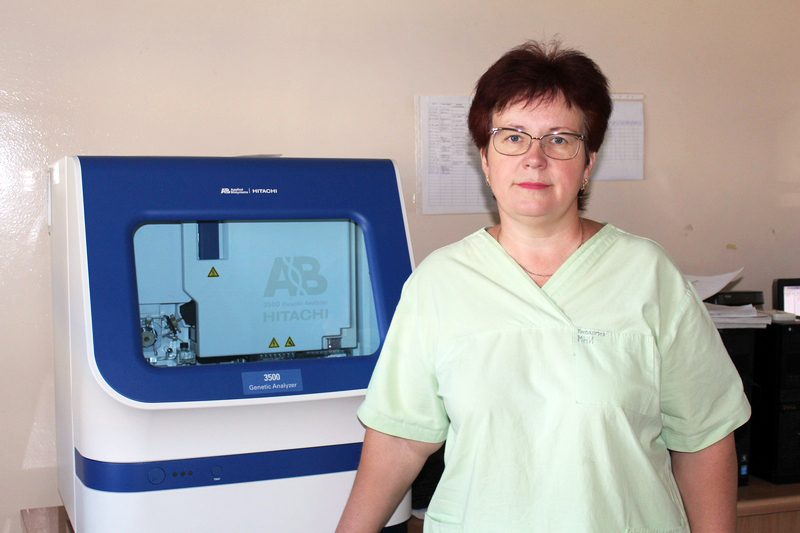

Figure: The **3500** at the Grodno oblast directorate, August 1, 2018: `3500 Genetic Analyzer` on the front plate and again on the panel inside the window, under `AB Applied Biosystems │ HITACHI`. [The committee’s page](https://sudexpert.gov.by/ru/grodno-news.html?news_id=5225).

*Image source: State Forensic Examination Committee · sudexpert.gov.by*

The 24-capillary variant is photographed in the genetics laboratory of the Scientific-Practical Center, badged the same way. (confidence: [verified — the model badge is legible in two separate sets](https://sudexpert.gov.by/ru/centr-news.html?news_id=6021) — verified against multiple independent high-quality sources)

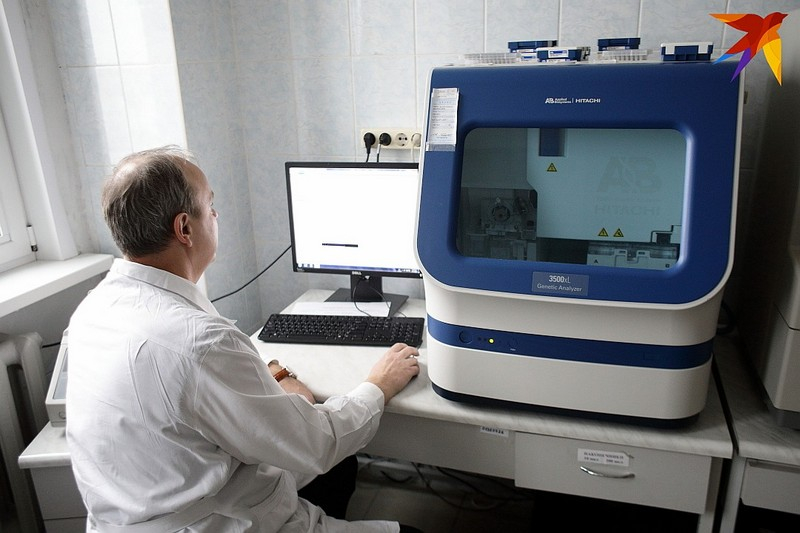

Figure: The [**3500xL** in operation](https://sudexpert.gov.by/ru/centr-news.html?news_id=6021) at the committee, published on its own news page on **March 11, 2019**.

*Image source: Komsomolskaya Pravda, republished by the State Forensic Examination Committee*

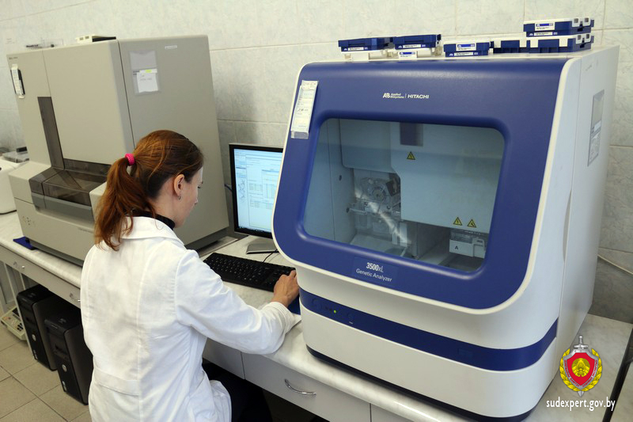

Figure: [The same model](https://zorkanews.by/28022020/chto-takoe-geneticheskaya-ekspertiza-i-d/) in the committee’s own photograph, served from its server under its crest and watermark, illustrating a SFEC explainer on genetic examination republished in February 2020.

*Image source: State Forensic Examination Committee · sudexpert.gov.by*

The 2019 photographs come from a *Komsomolskaya Pravda* report the committee republished on its Central Apparatus news page, crediting the source; the committee’s own crest appears on the laboratory wall in the same set. The 2020 image is the committee’s own, served from its server. Two independent sets, two years apart, showing the same platform in the same service. (confidence: [verified](https://sudexpert.gov.by/ru/centr-news.html?news_id=6021) — verified against multiple independent high-quality sources)

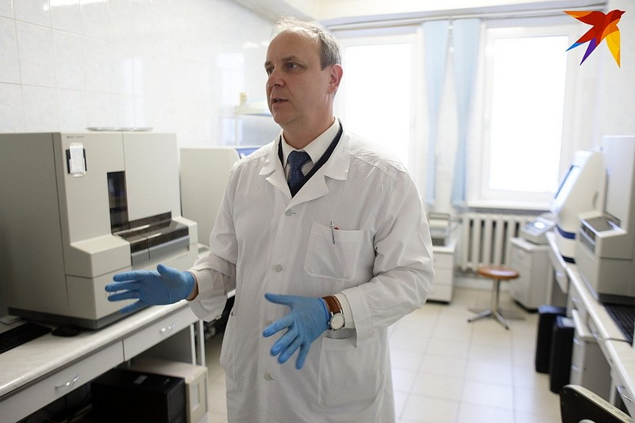

Figure: [The wider laboratory in the same 2019 set](https://sudexpert.gov.by/ru/centr-news.html?news_id=6021). The beige instrument at left has the proportions of an earlier Applied Biosystems analyzer — the 3100/3130 generation — but **its badge is not legible at this resolution**.

*Image source: Komsomolskaya Pravda, republished by the State Forensic Examination Committee*

### The installed base is regional, and outlasted the line

The committee’s own press photography puts Applied Biosystems capillary analyzers in two **oblast directorates**, not only the Scientific-Practical Center in Minsk — and on both sides of the February 2022 boundary.

On **January 31, 2022**, three weeks before the invasion of Ukraine, the Grodno oblast directorate published a photograph of a 3500-series analyzer with its door open, the operator holding a sample cassette; the interior panel carries the `AB │ HITACHI` mark. (confidence: [sourced — first-party](https://sudexpert.gov.by/ru/list_news_occurrence_n.html?news_id=8451) — a single identifiable source) On **August 24, 2022**, six months after it, the Vitebsk oblast directorate published a photograph of an earlier-generation instrument in routine casework use, a 96-well plate being loaded through the open front door. Its badge reads `Applied Biosystems │ HITACHI`, and `...tic Analyzer` is legible on the lower front panel. (confidence: [sourced — first-party](https://sudexpert.gov.by/ru/list_news_occurrence_n.html?news_id=9140) — a single identifiable source)

Neither model number is readable. On the Grodno instrument, the badge sits on the outer face of the open door and faces away; on the Vitebsk instrument it is occluded by the operator’s sleeve. The chassis of the first matches the 3500 / 3500xL — white shell, navy base band — and the second matches the 3100 / 3130 generation the committee has run since the 2000s, but the distinction within each family is not established here. (confidence: inferred — strong on generation, silent on model — derived by reasoning)

Two things follow for supplier risk. The Western installed base is **distributed across the regional network**, which is consistent with the Alprep cartridges described in (see section: substitution) implying AutoMate Express units outside Minsk, and means a legacy estimate built from central-office procurement alone will understate it. And a 3500-series instrument was in service in a regional laboratory three weeks before the invasion of Ukraine, with an earlier-generation instrument still in casework six months after it — the interval in which the vendors announced their exits. (confidence: inferred — strong — derived by reasoning)

### Still in service in 2026

On **August 19, 2026** — four years after the Western vendors announced their exits, and two years after the committee adopted a Russian capillary platform — the committee published a photograph of an analyzer with its door open. The maker’s mark `AB │ HITACHI` is legible; the model number is not. The Applied Biosystems platform is still in service. (confidence: [verified — the maker’s mark is legible](https://sudexpert.gov.by/ru/list_news_occurrence_n.html?news_id=15317) — verified against multiple independent high-quality sources)

> **The single most consequential fact for a supplier**
>
> An instrument fleet bought between 2013 and 2022 is still producing profiles in 2026, distributed across the regional directorates, and the profiles already in the database were generated on it. A decision to stop selling does not retire an installed instrument, and nothing in the record suggests these have been retired.

### What the committee is buying now

On **September 28, 2026**, the committee’s deputy chairman, A. S. Aleshkevich, signed the auction documents for an eight-lot reagent tender from its central apparatus: ceiling price **914,826 BYN**, bids closing October 13, delivery by December 17, 2026. (confidence: [sourced — the committee’s own auction documents](https://xtenders.by/tenders/3706701) — a single identifiable source) (link status: free account required) The tender page’s free view lists seven lots, with a matching seven-lot total; the auction documents, archived with this report, list eight.

Four of the lots are for a Chinese sequencing platform (DNBSEQ-G99RS) and are set out in (see section: chinese). **Lot 8**, the largest by value at 245,152 BYN, is the one that bears on the database directly: «Реагенты для идентификации личности» — reagents for personal identification, amplifying no fewer than 23 STR loci including Penta D and Penta E, in **100 packs of 200 reactions, 20,000 reactions in all**, for capillary electrophoresis. (the lot summary table gives 10,000 units; the technical annex gives 20,000 reactions twice, and is followed here)

The same lot confirms, in the committee’s own words, which instruments will run those reactions. It requires a matrix standard for no fewer than fifty six-dye spectral calibrations, split by instrument: «**3500xl – 10 калибровок** (для полимеров «POP-4» и «Восток-4»), **Нанофор-05 – 40 калибровок** (для полимеров «ПДМА-4» и «ПДМА-6»)». The Applied Biosystems 3500xL is being provisioned for continued use in September 2026, alongside the Russian platform — not replaced by it. (confidence: [sourced — the committee’s own auction documents](https://xtenders.by/tenders/3706701) — a single identifiable source) The one-to-four split is a rough indication that the Нанофор-05 might now carry most of the capillary work, though calibration counts reflect how often instruments are recalibrated as well as how many instruments there are. (confidence: inferred — weak on the ratio; strong that both are in service — derived by reasoning)

Twenty thousand reactions is a ceiling on profiles rather than a count of them — controls and repeat amplifications come from the same stock — but even discounted it is a single order larger than the entire 12,346-profile reference database the committee’s own scientists described in 2017. The tender does not say what the reactions are for, and ordinary casework and paternity testing draw on the same reagents. Its scale is nonetheless consistent with the program described in (see section: trigger): collection from political prisoners and from the relatives of exiles, by a committee whose chairman has said the database becomes effective at 40% population coverage. (confidence: inferred — moderate; the volume is documented, its purpose is not — derived by reasoning)

*2016–2026 — the parallel channel*

## 3. The Chinese approach, and what came of it

While the Western platform ran, a second supply relationship was under way. Its manufacturer says its analyzers reached Belarusian DNA laboratories; the committee itself documents a demonstration in Minsk in 2016 and an imminent purchase announced in 2017. What is missing at the end of it is evidence the purchase closed.

> **Original (zh):** 「GA118系列产品…成功应用于吉尔吉斯斯坦、安哥拉、白俄罗斯、阿根廷等国家的DNA实验室」
>
> **Translation:** “the GA118 series products have been applied with good results in over 100 municipal/county-level DNA laboratories in Zhejiang, Henan, Guizhou, Yunnan, Gansu and other regions, and have been successfully applied in DNA laboratories in Kyrgyzstan, Angola, **Belarus**, Argentina and other countries.”
>
> — FISCAN corporate news, fiscan.cn, September 29, 2022 (confidence: [sourced — first-party](https://www.fiscan.cn/news/show-49.html) — a single identifiable source)

FISCAN is **Beijing Zhongdun Anmin Analysis Technology Co., Ltd.** ([中盾安民](https://www.fiscan.cn/product/list-409.html)), a subsidiary of the Ministry of Public Security’s First Research Institute. Its GA118 capillary analyzer tracks the Applied Biosystems platform across two hardware generations, and the same chassis appears under at least four further names, one of them on the US Entity List. That device lineage is the subject of the companion report, [*Genealogy of a Genetic Surveillance Platform: The GA118 Genetic Analyzer*](https://otlet.tech/advocacy/reports/ga118-genealogy/), and is not restated here.

The claim above is corroborated by a sponsored corporate-profile segment, “Beijing Express,” produced by Guangtong News Agency and aired on Beijing Finance Channel on May 1, 2022, which states in near-identical language that the product line is “exported to more than ten countries, including Belarus and Argentina,” and carries an on-record quote from **Chen Li**, Executive Director of Beijing Zhongdun Anmin. The segment is republished on two further platforms, [Baijiahao](https://baijiahao.baidu.com/s?id=1731626723630151664&wfr=spider&for=pc) and Sohu — the same underlying sponsored piece, not independent corroboration. (confidence: [sourced, single primary source, republished](https://www.sohu.com/a/543029162_120449597) — a single identifiable source)

### A delegation photograph, and the visit it came from

A photograph, watermarked to the WeChat account “中盾安民” (Zhongdun Anmin / FISCAN), shows a Chinese delegation with uniformed Belarusian officials, Chinese and Belarusian flags on the table, and a wall crest reading «…судебных экспертыз». The manufacturer publishes it on its own company news page, immediately after the sentence naming Belarus. (confidence: [sourced](https://www.fiscan.cn/news/show-49.html) — a single identifiable source)

The photograph is not the manufacturer’s. It was taken at the State Forensic Examination Committee on **November 1, 2016**, during the official visit of a delegation of forensic institutions of the Chinese Ministry of Public Security, and the committee published its own account of that visit with four photographs of its own. Two of the four Chinese visitors appear in both sets **wearing the same clothes** — a woman in a navy pinafore over a white shirt, and a man in thin-framed glasses and a patterned gold-and-red tie. Same people, same dress, same room: the manufacturer’s image is a frame from that day. (confidence: [verified — two individuals matched across both sets, identical dress](https://sudexpert.gov.by/en/list_news_occurrence_n.html?news_id=2550) — verified against multiple independent high-quality sources)

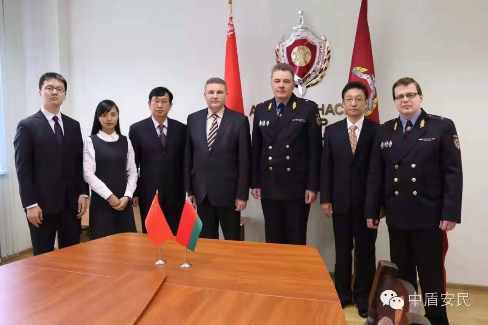

Figure: The photograph as the manufacturer publishes it, uncaptioned. [Its page at fiscan.cn](https://www.fiscan.cn/news/show-49.html).

*Image source: 中盾安民 (Zhongdun Anmin / FISCAN) · published at fiscan.cn*

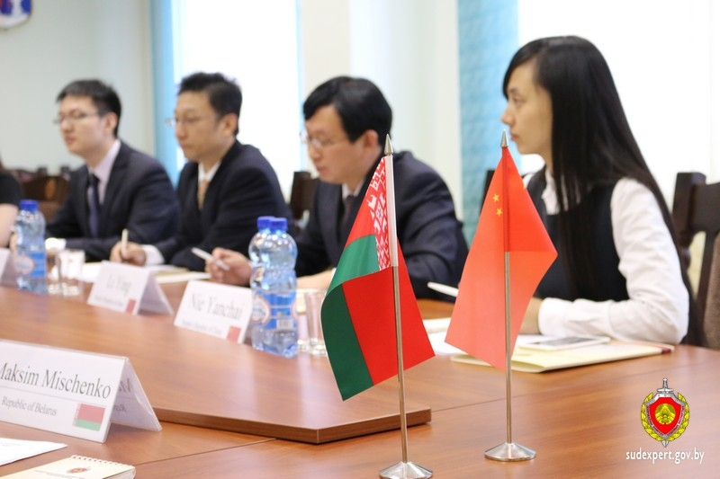

Figure: The same delegation in talks at the committee, November 1, 2016, published by the committee. The nameplates are legible. [The committee’s account](https://sudexpert.gov.by/en/list_news_occurrence_n.html?news_id=2550).

*Image source: State Forensic Examination Committee · sudexpert.gov.by*

That correction matters twice over. The delegation is the **ministry’s**, not the company’s — the committee describes it as one of MPS forensic institutions — so the image does not provide direct evidence of a FISCAN commercial visit. And the date is no longer open: what the manufacturer reproduced in 2022, without a caption, was a committee photograph six years old.

### What the committee says happened that day

The committee’s account is not a courtesy note. It records the Chinese side demonstrating equipment and pricing it against what Belarus already ran:

> **Translation:** “During their visit to Minsk, the Chinese experts in detail familiarized with the structure and specificity of activity of the State Forensic Examination Committee, participated in the international specialized exhibition”Human and Security” and **demonstrated analytical equipment in the field of genetic research, designed and produced in China**. Chinese side presented a sample of genetic analyzer that has similar settings with equipment that Belarusian specialists are using now. However, **the cost of Chinese analog may be considerably lower**. As a result of meetings and talks, the sides agreed to hold the Chinese test equipment and related reagents, as well as an internship in China Belarusian specialists for training to work on the equipment.”
>
> — State Forensic Examination Committee, November 1, 2016 (confidence: [sourced — first-party](https://sudexpert.gov.by/en/list_news_occurrence_n.html?news_id=2550) — a single identifiable source)

One of the committee’s photographs shows the instrument that was demonstrated. It is badged **GA118**, “Genetic Analyzer”, on a blue-paneled chassis — the earlier generation — with a Chinese official’s hand on the raised lid and a Belarusian official watching.

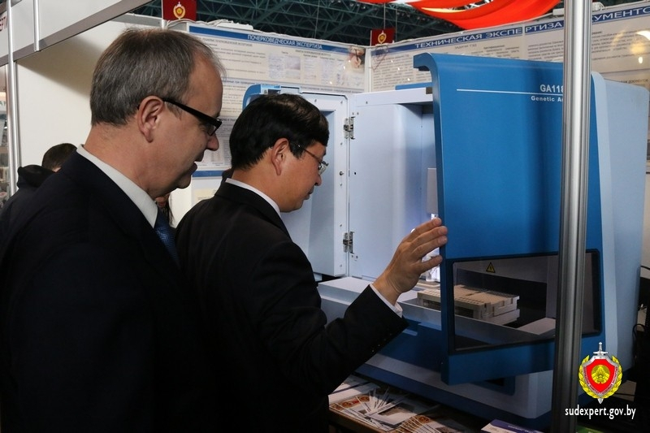

Figure: The demonstrated instrument, badged GA118, at the “Human and Security” exhibition in Minsk, November 1, 2016. The stand banner reads «ТЕХНИЧЕСКАЯ ЭКСПЕРТИЗА»; the committee’s crest is behind it. [The committee’s account](https://sudexpert.gov.by/en/list_news_occurrence_n.html?news_id=2550).

*Image source: State Forensic Examination Committee · sudexpert.gov.by*

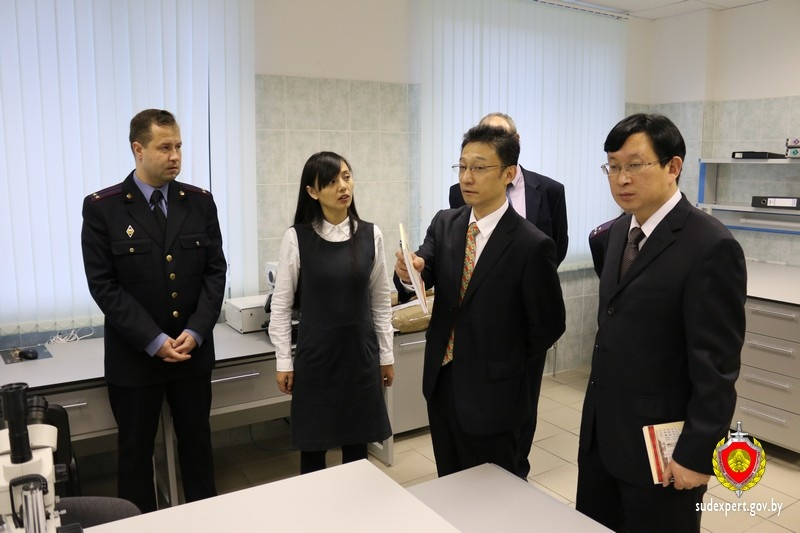

Figure: The same delegation inside a committee laboratory on the same day.

*Image source: State Forensic Examination Committee · sudexpert.gov.by*

A named GA118, in Minsk, in 2016, photographed and published by the Belarusian forensic committee itself. It is a demonstration rather than an installation — but it removes any question of whether the machine and the customer were ever in the same room. (confidence: [verified — the badge, the committee’s own photograph, and its own account](https://sudexpert.gov.by/en/list_news_occurrence_n.html?news_id=2550) — verified against multiple independent high-quality sources)

The equipment the Chinese analyzer was said to have “similar settings” to is the platform documented in (see section: documented): the Applied Biosystems 3500-series platform the committee bought in 2013 and has photographed repeatedly since. That closes the comparison the whole Chinese approach rests on — the platform the GA118 was built to track, generation for generation, is the platform the Belarusian committee was running when a Chinese delegation offered it a cheaper equivalent. (confidence: inferred — strong; the badges, the registry entry, and the committee’s own wording — derived by reasoning)

### November 2017: the committee says it is about to buy

A year after the demonstration, the committee put the purchase on the record itself. Announcing a further MPS visit on **November 23, 2017**, its Deputy Chairman and Chief State Forensic Expert, **Yuri Ovsiyuk**, told BelTA that Chinese equipment was about to be bought, and why:

> **Translation:** “The cost of genetic examinations for citizens can be reduced due to **the purchase of Chinese equipment**… A special topic of the negotiations was the purchase of Chinese-made equipment and reagents for genotyposcopic research… Such equipment **has already been tested in the State Committee**. The tests confirmed identical parameters and capabilities with other foreign analogues. «We can say that **this visit is the final one before signing documents for the purchase of equipment that we tested last year**. Its price is low… a decrease of about 15-20% is quite possible»… Belarusian experts got acquainted with the equipment from China **at the last year’s exhibition «A man and security»**. At the request of the Belarusian side, **the Chinese colleagues left their developments free of charge**. Experts tested them and **Chinese manufacturers launched a new line of devices based on Belarusian recommendations**. **Supplies of equipment, related reagents and consumables are expected in the first half of 2018**.”
>
> — State Forensic Examination Committee, November 23, 2017 (confidence: [sourced — first-party](https://sudexpert.gov.by/en/list_news_occurrence_n.html?news_id=3765) — a single identifiable source)

Four things in that follow from the 2016 visit and are stated by the customer, not the vendor. The equipment was the same equipment: «A man and security» is the exhibition at which the committee photographed the badged GA118. It did not go home — the Chinese side **left it in Belarus free of charge** and the committee tested it. The manufacturer then **changed its product line on Belarusian recommendations**, which is a development relationship rather than a sale. And the committee expected delivery within six months. (confidence: [verified — the committee’s own statement, naming the 2016 exhibition](https://sudexpert.gov.by/en/list_news_occurrence_n.html?news_id=3765) — verified against multiple independent high-quality sources)

Figure: The MPS delegation taking notes inside the committee’s genetic examination laboratory, November 23, 2017. The instrument behind them has the navy front panel and rounded window of an **Applied Biosystems 3500** series analyzer — the platform photographed with a legible badge above — though this frame’s own badge is not legible at this resolution. [The committee’s account](https://sudexpert.gov.by/en/list_news_occurrence_n.html?news_id=3765).

*Image source: State Forensic Examination Committee · sudexpert.gov.by*

The head of the Chinese delegation is named, and confirms the counterpart identified below: **The Deputy Director of the Institute of Forensic Science of the Ministry of Public Security** describes the relationship as technical rather than commercial — “Our Department is responsible for technical development, so I hope that we will also cooperate in terms of scientific and technical development” — and raises joint research, staff exchanges, and extending cooperation to metallographic, X-ray, and document examination. (confidence: [sourced](https://sudexpert.gov.by/en/list_news_occurrence_n.html?news_id=3765) — a single identifiable source)

What is still not here is completion. A stated intention to sign, a stated delivery window, and a stated discount are not a contract, a delivery note, or an installed instrument, and the committee published nothing afterwards to say the purchase closed. But the gap between the 2016 demonstration and the 2022 deployment claim is no longer unexplained: the customer said in 2017 that it was buying. (confidence: inferred — strong on intent, silent on completion — derived by reasoning)

### A second branch, shown at a Moscow trade fair in 2023

The next generation of the same hardware platform reached the Belarusian forensic service a second time, through its Russian branch. At **Analitika Expo 2023**, held April 11–14, 2023, at Crocus Expo outside Moscow, a delegation from **Белсудэкспертобеспечение** — the SFEC-subordinate supply enterprise — attended with representatives of the committee itself, and both published photographs of a G-series analyzer on the stand of **ООО «Генные Технологии Здоровья»** (GTZ), the Moscow company that registered the instrument with the Russian health-device regulator. Staff on the stand wear «ГТЗ»-marked lab coats; the backdrop advertises **«Криминалистика»** — forensics. (confidence: [verified — the lab-coat mark, the stand copy, and the machine](https://belsudmed.by/news/direktor-posetil-vystavku) — verified against multiple independent high-quality sources)

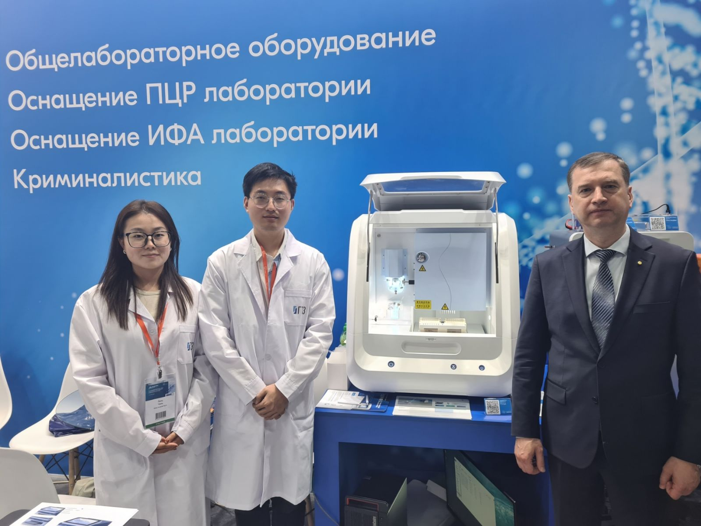

Figure: The «ГТЗ» stand at Analitika Expo 2023: staff in ГТЗ-marked lab coats, the G-series analyzer with its lid raised, and a Belarusian official from the committee’s supply enterprise. [The enterprise’s account](https://belsudmed.by/news/direktor-posetil-vystavku).

*Image source: Белсудэкспертобеспечение · belsudmed.by*

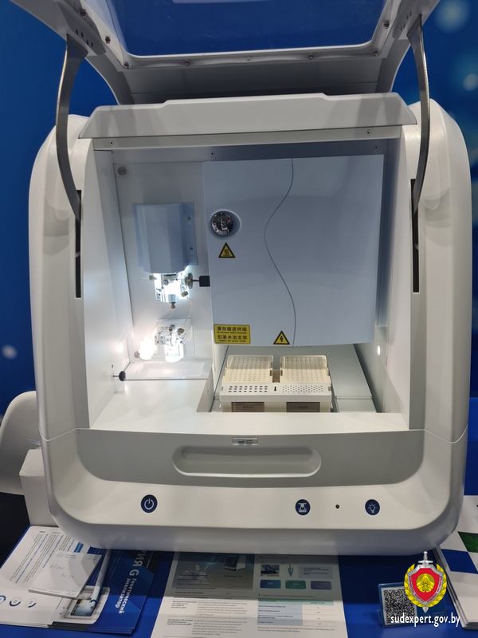

Figure: The same analyzer under the committee’s own emblem and watermark, served from its own server. The interior warning labels are Chinese and English; the brochure at the foot of the frame reads «СЕРИЯ G». [The image on the committee’s server](https://sudexpert.gov.by/7gfshjsgrhsfhf.jpg).

*Image source: State Forensic Examination Committee · sudexpert.gov.by*

A trade stand is not a laboratory, and a machine shown is not a machine bought: the enterprise’s own account reports agreements on possible long-term contracts and the supply of **reagent kits** for testing, not instruments, and its catalog lists the Russian Nanofor 05 rather than the G series. (confidence: [unverified — no distribution relationship found](https://belsudmed.by/news/direktor-posetil-vystavku) — not confirmable from available sources) What the 2016 and 2023 photographs establish together is that two separate branches of this hardware genealogy were each put in front of the Belarusian forensic service, and each photographed by it.

### A third platform, in the 2026 tender: sequencing, from FGI

The committee’s September 2026 tender ((see section: documented)) specifies a Chinese instrument outright. Four of its eight lots, worth 488,800 BYN together, are reagent kits for massively parallel sequencing, and every one is written to the same pairing: reagents «для применения на генетическом анализаторе **DNBSEQ-G99RS** с последующим анализом результатов с использованием **FGID Forensic DNA Analysis System**» — for use on the DNBSEQ-G99RS sequencer, with results analyzed in the FGID software. The tender lists this as a critical requirement, and obliges the supplier to train the committee’s experts. (confidence: [sourced — the committee’s own auction documents](https://xtenders.by/tenders/3706701) — a single identifiable source)

The four kits go well beyond identification:

- **Lot 1** — FGID Forensic Mitochondrial Whole Genome Kit G99: the full mitochondrial genome, for maternal-line kinship.
- **Lot 2** — appearance and ancestry: skin, eye, and hair color, widow’s peak, joined eyebrows, double eyelid, earlobe attachment, hair texture, freckles, and baldness, with autosomal and Y-chromosome biogeographic markers.
- **Lot 3** — FGI GeneSeek Forensic Genealogy Inference Kit: no fewer than 19,000 SNPs, to establish kinship **to at least the fourth degree**.
- **Lot 4** — FGID Forensic Four-in-One DNA Typing Kit G99 V3.0: STRs and SNPs in one run.

The DNBSEQ-G99RS is a sequencer from **MGI Tech**, BGI’s instrument maker, using its DNA-nanoball chemistry. The Lot 4 kit on that instrument is the subject of a 2024 validation study, *“Parallel sequencing of 170 STR and 132 SNP markers using the FGID forensic four-in-one DNA typing kit on the DNBSEQ-G99RS platform,”* which names the maker as “FGI Tech (MGI, Shenzhen, China)” and includes an author from **BGI Forensic Technology Co., Ltd, Shenzhen**. (confidence: [sourced](https://pmc.ncbi.nlm.nih.gov/articles/PMC12224613/) — a single identifiable source) BGI Forensic Technology (Shenzhen) Co., Ltd. is recorded as an alias of **Forensic Genomics International** — the FGI that sells the GA118 under its own brand, set out in the [companion report](https://otlet.tech/advocacy/reports/ga118-genealogy/). (confidence: [sourced — sanctions record, collated by OpenSanctions](https://www.opensanctions.org/entities/NK-BqY2z8HLUXD7YEzNJGDqw6/) — a single identifiable source)

FGI carries two US designations. The Commerce Department added it to the **Entity List** with effect from March 2, 2023, finding that its “collection and analysis of genetic data poses a significant risk of contributing to monitoring and surveillance by the government of China, which has been utilized in the repression of ethnic minorities in China.” (confidence: [verified — the Federal Register notice](https://www.govinfo.gov/content/pkg/FR-2023-03-06/html/2023-04558.htm) — verified against multiple independent high-quality sources) The Defense Department lists it as a **Chinese military company** under Section 1260H, as a subsidiary of BGI Group, in its January 2025 and June 2026 notices. MGI Tech, the sequencer’s maker, is listed in both in its own right. (confidence: [verified — the 2026 notice](https://www.govinfo.gov/content/pkg/FR-2026-06-10/html/2026-11571.htm) — verified against multiple independent high-quality sources) Since October 29, 2026, it has also been on the Department of Homeland Security’s entity list under the Uyghur Forced Labor Prevention Act. (confidence: [verified — the DHS list](https://www.dhs.gov/uflpa-entity-list) — verified against multiple independent high-quality sources)

Reagents specified to one maker’s instrument and one maker’s analysis software, with training of the committee’s own experts as a condition, imply a DNBSEQ-G99RS installed or about to be. (confidence: inferred — strong — derived by reasoning) No delivery note or serial number has been found, and the tender is still open. But unlike the capillary analyzer offered in 2016, this is not a machine shown at a stand: it is the committee writing its own requirements around a Chinese sequencing platform whose maker and whose forensic-kit supplier are both designated Chinese military companies, the latter also on the Entity List for surveillance used against ethnic minorities. The kinship lot matters most for this report’s argument. Viasna documents samples being taken from exiles’ relatives so that people abroad “can be identified” ((see section: trigger)); kinship to the fourth degree extends that reach beyond first cousins. (confidence: inferred — moderate on purpose; the capability is documented, its use is not — derived by reasoning)

### The Chinese forensic technology channel

Belarusian and Chinese state sources document a forensic relationship with the Ministry of Public Security running from 2016 — beginning, that same year, with a GA118 demonstrated in Minsk and priced against the committee’s existing equipment, six years before the manufacturer claimed deployment.

| When | What, and who says so | Confidence |
|----|----|----|
| June 2016 | An SFEC delegation visits the MPS **Institute of Forensic Science**. | (confidence: [sourced](https://sudexpert.gov.by/en/list_news_occurrence_n.html?news_id=6485) — a single identifiable source) |
| November 2016 | An MPS forensic delegation visits Minsk, demonstrates a Chinese genetic analyzer at the «Human and Security» exhibition — photographed by the committee, **badged GA118** — argues it costs considerably less than what Belarus runs, and agrees to trials of Chinese equipment and reagents plus training in China. | (confidence: [verified](https://sudexpert.gov.by/en/list_news_occurrence_n.html?news_id=2550) — verified against multiple independent high-quality sources) |
| November 2017 | The MPS visits again. The committee’s deputy chairman says the equipment tested in 2016 was **left in Belarus free of charge**, that the manufacturer **revised its product line on Belarusian recommendations**, that this is **the final visit before signing purchase documents**, and that supplies are **expected in the first half of 2018**. | (confidence: [verified](https://sudexpert.gov.by/en/list_news_occurrence_n.html?news_id=3765) — verified against multiple independent high-quality sources) |
| April 2018 | SFEC chairman Andrei Shved tells BelTA there are “arrangements on the acquisition of the Chinese equipment for genetic fingerprinting”, on cost grounds, and that an agreement is planned with the **Material Evidence Identity Center** at the MPS. | (confidence: [sourced](https://eng.belta.by/society/view/belarus-considers-purchasing-dna-testing-equipment-from-china-110942-2018/) — a single identifiable source) |
| 2018 | An agreement on cooperation is signed between the two agencies. | (confidence: [sourced](https://sudexpert.gov.by/en/list_news_occurrence_n.html?news_id=6485) — a single identifiable source) |
| August 2019 | Experts from the MPS institute test **genetic reagents** at «Belsudekspertobespechenie», an enterprise subordinate to the SFEC. Days later the MPS runs a two-week seminar at the SFEC Central Office listing **DNA forensic examination** first among its subjects. | (confidence: [sourced](https://sudexpert.gov.by/en/list_news_occurrence_n.html?news_id=6485) — a single identifiable source) |
| September 2022 | FISCAN names Belarus among the countries whose DNA laboratories run its GA118 analyzers. | (confidence: [sourced](https://www.fiscan.cn/news/show-49.html) — a single identifiable source) |
| April 2023 | The committee’s supply enterprise and the committee itself photograph a G-series analyzer on the GTZ stand at Analitika Expo, Moscow. | (confidence: [sourced](https://belsudmed.by/news/direktor-posetil-vystavku) — a single identifiable source) |
| June 2025 | A delegation of the MPS **Examination Centre** visits the SFEC’s Scientific and Practical Center, “continuing” its familiarization. | (confidence: [sourced](https://www.instagram.com/sudexpert_by/p/DK2fvOXonQq/?img_index=5) — a single identifiable source) |
| October 2025 | MPS and Ministry of Justice delegations visit the SFEC — the same room as November 2016, with one Belarusian official recognizable in both sets. | (confidence: [sourced](https://www.instagram.com/p/DPWYDydDANi/?img_index=9) — a single identifiable source) |

The documented MPS–SFEC channel

*Sources: State Forensic Examination Committee, November 1, 2016, and November 23, 2017 · BelTA, April 13, 2018 · State Forensic Examination Committee, August 27, 2019 · Белсудэкспертобеспечение, April 2023 · the committee’s Instagram account, June 13, 2025, and October 2025 · FISCAN corporate news, September 29, 2022. The 2019 item is the source for the June 2016 and 2018 entries, which it recounts; the November 2016 entry is the committee’s own contemporaneous report.*

Figure: The August 2019 seminar at the SFEC Central Office. Officials of the Chinese Ministry of Public Security, two of them in uniform, sit at the panel table; the audience is uniformed committee staff. The published program lists **DNA forensic examination** first among the subjects taught. [The committee’s own account](https://sudexpert.gov.by/en/list_news_occurrence_n.html?news_id=6485).

*Image source: State Forensic Examination Committee · sudexpert.gov.by*

### Who the Chinese counterpart is

The counterpart is named three different ways across these sources — Material Evidence Identity Center in 2018, Institute of Forensic Science in 2019, Examination Centre in 2025. They are one body: the Ministry of Public Security’s 公安部物证鉴定中心, its Material Evidence Identification Center, which was **renamed** 公安部鉴定中心 in 2022 — dropping “material evidence” from the name. That rename is why the Belarusian sources use the longer name in 2018 and the shorter «Центр экспертизы» in 2025. (confidence: [verified](https://baike.baidu.com/en/item/Ministry%20of%20Public%20Security%20Identification%20Center/36766) — verified against multiple independent high-quality sources)

The United States government treats the three renderings as one entity explicitly. When the Commerce Department added the body to the Entity List in June 2020, it listed the other two names as its aliases:

> **Translation:** “Ministry of Public Security’s Institute of Forensic Science of China, including two aliases (Forensic Identification Center of the Ministry of Public Security of the People’s Republic of China and Material Identification Center of the Ministry of Public Security of the People’s Republic of China).”
>
> — Bureau of Industry and Security, *Federal Register* 85 FR 34503, June 5, 2020 (confidence: [sourced — primary](https://www.govinfo.gov/content/pkg/FR-2020-06-05/html/2020-10868.htm) — a single identifiable source)

The grounds for sanctions were its involvement in persecutions across Xinjiang: the entity was among nine “implicated in human rights violations and abuses in the implementation of China’s campaign of repression, mass arbitrary detention, forced labor and high-technology surveillance against Uighurs, Kazakhs, and other members of Muslim minority groups.” It was removed from the list on November 17, 2023. (confidence: [verified](https://www.govinfo.gov/content/pkg/FR-2023-11-17/html/2023-25557.htm) — verified against multiple independent high-quality sources)

One ambiguity in the English name survives, and it is not idle. The **Academy of Forensic Science** in Shanghai — a separate body, under the **Ministry of Justice** — was for decades called the Institute of Forensic Science, Ministry of Justice. Two ministries have therefore used similar English names for two different institutes, so the name alone identifies neither. The Ministry of Justice is also part of this relationship in its own right: it sent a delegation alongside the MPS in October 2025. (confidence: [sourced](https://www.tandfonline.com/doi/full/10.1080/20961790.2021.1912877) — a single identifiable source) Here the name does not have to carry the identification, because the Belarusian source states the ministry: the committee’s 2019 item records the June 2016 visit as one to “the Institute of Forensic Science **of the Ministry of Public Security** of the People’s Republic of China.” (confidence: [sourced — first-party](https://sudexpert.gov.by/en/list_news_occurrence_n.html?news_id=6485) — a single identifiable source)

Two cautions remain. The 2019 seminar and the reagent testing concern Chinese equipment and reagents generally; **neither names FISCAN or the GA118**. And a purchase announced as imminent in 2017, and restated in 2018, is still not a purchase.

> **What the Chinese record does and does not establish**
>
> It establishes, from the committee’s own dated accounts, that a **GA118 was demonstrated to the State Forensic Examination Committee in Minsk in November 2016** and photographed by it; that the machine was then left in Belarus free of charge and tested, and its maker revised the product line on Belarusian recommendations; that in November 2017 the committee’s deputy chairman announced the purchase as imminent, and restated the intention to BelTA in 2018 on cost grounds; that MPS experts tested genetic reagents inside an SFEC-subordinate enterprise in 2019; and that the manufacturer claimed Belarusian deployment in September 2022.
>
> It does not establish that the purchase completed. No contract, delivery note, or serial number has been found, the public procurement registry records no Chinese analyzer bought by the committee, and nothing here shows a GA118 installed and running at the SFEC. A documented intention to buy and a documented deployment somewhere in Belarus are two findings, not one. On the later record — a Russian capillary platform adopted from 2023, and the Western platform still in service in 2026 — the capillary-analyzer sale may not have happened. (confidence: inferred — strong — derived by reasoning) The inference is strong on the channel and on stated intent; the later record points away from completion. The Chinese thread did not end there: in September 2026 the committee wrote its own sequencing requirements around an MGI instrument and FGI’s forensic kits and software, set out above.

*Presence over time*

## 4. Who was supplying what, and when

Solid bars mark periods with direct documentary evidence. Dashed outlines mark periods where presence is plausible but unconfirmed: after each Western vendor’s announced exit, while the installed base may remain in service, and for Chinese suppliers from 2020 to 2022, when only the manufacturer’s own claim exists.

**Timeline**

Axis: 2000 to 2027.

Events: Feb 2022 — invasion, sanctions.

- Thermo Fisher (Applied Biosystems) — western · documented 2000–2026

- Promega (PowerPlex line) — western · documented 2004–2023 · unconfirmed 2023–2027

- QIAGEN (extraction & X-STR) — western · documented 2015–2023 · unconfirmed 2023–2027

- Verogen → QIAGEN (NGS platform) — western · documented 2020–2023 · unconfirmed 2023–2027

- Belarusian producers (Algimed Techno, IBOCh NAS) — belarusian · documented 2016–2027

- Chinese suppliers (GA118 trials 2016–19; G-series 2023; FGI/MGI tender 2026) — chinese · documented 2016–2020, 2023–2027 · unconfirmed 2020–2023

- Russian suppliers (Sintol 2017, Nanofor 2023) — russian · documented 2017–2027

The shape matters more than any single bar. Western presence is long, deep, and — for Thermo Fisher — documented right through to 2026 by the committee’s own photography. Eastern presence begins *before* the February 2022 line, and neither strand is a sanctions response: the Chinese approach opens in 2016, with equipment demonstrated and left in Belarus for trials, and a Russian supplier (Sintol) filled a sole-source reagent order in 2017. (confidence: [sourced](https://icetrade.by/tenders8000/view/434747) — a single identifiable source) No Chinese instrument is confirmed in use at the committee before 2022.

*The dividing line*

## 5. Before February 2022, and after

Any fair assessment has to distinguish two separate situations. Before the invasion, selling forensic DNA kits to a national forensic service may have passed as ordinary commerce of a kind conducted with almost every state forensic institute in the world — if one was willing to overlook the repressive nature of the Belarusian regime. After February 2022 the legal position, the reputational position, and the factual position all changed — and so did the character of what the Belarusian database was being used for.

> **Before · to February 23, 2022**
>
> #### Commercial position
>
> Open, routine supply. Kits and instruments from all three vendors appear in SFEC publications across two decades. Promega chemistry [from 2004](https://doi.org/10.1016/j.fsigen.2008.10.003); the full Applied Biosystems stack across a stated “15-year expert practice”; QIAamp extraction registered as an official SFEC method.
>
> #### What changed underneath it
>
> The August 2020 election and the crackdown that followed. From that point a supplier’s human-rights due diligence on a Belarusian law-enforcement customer could no longer rest on the assumption of ordinary criminal-justice use — even though the coercive DNA collection now reported was not yet public.
>
> #### What was still being bought, right up to the line
>
> icetrade.by shows the SFEC building out NGS capacity through this whole window: two high-throughput sequencing platforms bought five weeks apart in autumn 2018, an Illumina MiSeq FGx through a Russian reseller (confidence: [sourced](https://icetrade.by/tenders8000/view/844543) — a single identifiable source) and a Thermo Fisher Ion GeneStudio S5 through a Belarusian one (confidence: [sourced](https://icetrade.by/tenders8000/view/885046) — a single identifiable source), and a 2019 contract for Illumina Nextera XT library-prep kits. (confidence: [sourced](https://icetrade.by/tenders/all/view/699701) — a single identifiable source) The forensic consumables proved harder to buy. The ForenSeq and MiSeq FGx lots failed in the 2019 tender, and again in a [July 2020 tender](https://icetrade.by/tenders/all/view/823410) and its August repeat, where every lot was declared failed. (confidence: [sourced](https://icetrade.by/tenders/all/view/830011) — a single identifiable source) Whatever caused that failure, it predates the invasion by at least 18 months.
>
> #### Assessment
>
> Supply itself was not unlawful, although it created the technical foundation and expertise for the emerging misuse. The exposure is **retrospective and reputational**: technology sold routinely became the operating layer of a database now being filled coercively.

> **After · February 24, 2022 onward**
>
> #### Vendor responses
>
> **Thermo Fisher** paused non-critical operations in March 2022, then [ceased sales and manufacturing](https://leave-russia.org/thermo-fisher-scientific) in Russia and Belarus; regional legal entity liquidated December 2023. **QIAGEN** stated in its [2022 annual report](https://corporate.qiagen.com/files/doc_downloads/other_reports/2022-IFRS-Annual-Report.pdf) that it suspended business operations in Russia and Belarus. **Promega** — no public statement located. (confidence: unverified — not confirmable from available sources)
>
> #### What an exit does not do
>
> Forensic instruments have ten-to-fifteen-year service lives. Ceasing sales stops new revenue; it does not retire an AB 3500 or a MiSeq FGx, and it does not stop either machine producing profiles for the database.
>
> #### Assessment
>
> Exposure shifts from transactional to **legacy and diversion**: installed base still running, consumables and service potentially reaching Belarus through third countries, and — in one case — a platform acquired after the exit decision.

*Human rights exposure*

## 6. ESG risk, vendor by vendor

The framework that matters here is the [UN Guiding Principles on Business and Human Rights](https://www.ohchr.org/en/publications/reference-publications/guiding-principles-business-and-human-rights), which distinguish causing an adverse impact, contributing to it, and being *directly linked* to it through a business relationship. None of the three vendors plausibly causes coerced DNA collection. The live question for all three is direct linkage — and the salience of that linkage rose sharply once the database began drawing samples from a politically targeted population.

Two aggravating characteristics are specific to this technology rather than to any one company. Forensic DNA profiles are **permanent and familial**: a profile identifies relatives who never gave a sample, which is precisely the mechanism Viasna documents being used against exiles. And the SFEC’s stated ambition — appearance prediction, ancestry inference, the [ДНК-Внешность-Бел](https://www.belarus.by/en/press-center/press-release/work-underway-on-dna-appearance-bel-database-in-belarus_i_0000074269.html)[database](https://www.belarus.by/en/press-center/press-release/work-underway-on-dna-appearance-bel-database-in-belarus_i_0000074269.html) — goes beyond identification into phenotyping, which is exactly what the ForenSeq panel’s pigmentation and biogeographic SNPs deliver. (confidence: inferred — moderate — derived by reasoning)

### Thermo Fisher Scientific

*Waltham, Massachusetts · NYSE: TMO*

Footprint  
Deepest of the three: the entire CE platform, four amplification and quantification kits, and the genotyping software. Also the only vendor appearing in the SFEC’s official methods register for a human-ID-adjacent product line. In November 2018 the committee also bought, through a Minsk reseller, its HID Ion GeneStudio S5 sequencer with Precision ID STR, mitochondrial, ancestry, and DNA-phenotyping panels. (confidence: [sourced](https://icetrade.by/tenders8000/view/885046) — a single identifiable source)

Legacy exposure  
(severity: High) — the database’s operating layer for two decades, and still in service in 2026.

Current exposure  
(severity: Moderate) — clean, documented exit; residual installed base.

Disclosure  
Dated and naming Belarus alongside Russia, but recorded by a third-party tracker rather than by the company. A letter of September 24, 2026, to the company asking whether the exit covers human-identification consumables, instrument servicing, and GeneMapper ID-X licensing, received no response by its October 9 deadline.

The strongest mitigation of the three on paper, though the questions that matter for an installed base (consumables, servicing, and licensing) remain unanswered. The residual issue is not conduct but consequence: an instrument fleet that a Belarusian manufacturer is now actively supporting (see below).

### Promega

*Madison, Wisconsin · privately held*

Footprint  
Amplification chemistry from 2004 to at least 2022, including the PowerPlex loci on which the national criminal database was constructed.

Legacy exposure  
(severity: High) — foundational to the database’s locus set.

Current exposure  
(severity: Moderate), and less well characterized than the others.

Disclosure  
(severity: Gap) — no public statement on Russia or Belarus located. A letter of September 10, 2026, to the company asking whether it has stopped supplying human-identification products to Belarusian and Russian authorities, and how it guards against diversion through distributors, received no response by its September 25 deadline.

The disclosure gap should be read carefully. **Absence of a public statement is not evidence of continued sales**, and no evidence of any post-2022 sale to Belarus was found. As a privately held company Promega faces none of the disclosure obligations that produced QIAGEN’s annual-report language. But for an ESG analyst the practical consequence is the same: for this vendor alone, there is no dated statement of any kind to rely on, none was given when the company was asked directly, and the position must be inferred rather than read.

### QIAGEN

*Venlo / Hilden · NYSE & FSE: QGEN*

Footprint  
Narrowest legacy chemistry — one extraction kit, one X-STR kit — but, since January 2023, ownership of the SFEC’s entire forensic NGS platform.

Legacy exposure  
(severity: Moderate)

Current exposure  
(severity: Moderate) — direct company denial obtained Sept. 7, 2026; see update below. Structurally still the most awkward of the three, since the denial covers sales, not explicitly servicing.

Disclosure  
Explicit — the audited 2022 annual report, and a written response to a direct inquiry, September 7, 2026.

> **Translation:** “QIAGEN decided in 2022 to suspend business operations in Russia and Belarus, with sales in these countries (along with Ukraine) representing less than 1% of total annual sales.”
>
> — QIAGEN N.V., 2022 IFRS Annual Report · [full filing (PDF)](https://corporate.qiagen.com/files/doc_downloads/other_reports/2022-IFRS-Annual-Report.pdf)

> **The Verogen complication**
>
> QIAGEN [completed its acquisition of Verogen](https://corporate.qiagen.com/English/newsroom/press-releases/press-release-details/2023/QIAGEN-Completes-Acquisition-of-Verogen-Strengthening-Leadership-in-Human-ID--Forensics-With-NGS-Technologies/default.aspx) on **January 3, 2023**, for \$150 million, gaining exclusive distribution rights to the forensic MiSeq FGx. A distribution agreement had already been in place since June 2021. The SFEC’s sequencing work was performed before the acquisition and correctly attributed at the time to Verogen and Illumina.
>
> The consequence is that QIAGEN acquired, *after* its own decision to suspend Belarusian business, an installed base in Belarus consisting of a **closed forensic system**: instrument-locked proprietary reagents and vendor-licensed analysis software. Unlike a generic capillary analyzer, a MiSeq FGx cannot readily be kept running on substitute consumables. Whether reagent supply, servicing, or software licensing to Belarus continued through Verogen’s separate channels after the acquisition is **not answerable from open sources** — and is the single most consequential unresolved question in this assessment. It is sharpened, not settled, by icetrade.by: the SFEC’s two public 2020 tenders for exactly these ForenSeq/MiSeq FGx consumables both failed outright, yet the kits are documented in casework by 2023 — see (see section: limits) for how that gap might be read. (confidence: unverified — not confirmable from available sources)
>
> This is an integration and due-diligence question, not an allegation. It is also a generalizable one: acquiring a forensics business means acquiring its customer list, including customers in jurisdictions the acquirer has already exited.

> — UPDATE · 7 SEPTEMBER 2026
>
> **Translation:** “QIAGEN decided to suspend its business in Russia and Belarus early in 2022. With the exception of limited tuberculosis detection assay deliveries under dedicated WHO projects, we have not sold into Russia or Belarus since then and maintain stringent controls to ensure this is enforced.”
>
> — Dr. Philipp von Hugo, VP & Head of Global Legal Affairs and Compliance, QIAGEN · written response to a direct inquiry from this report’s author, September 7, 2026

This directly addresses the open question above. QIAGEN states no sales into Russia or Belarus since early 2022, with one named exception — tuberculosis- diagnostic deliveries under WHO humanitarian programs, unrelated to human-identification products — and describes “stringent controls” to enforce this. It is a direct, dated, on-record statement from senior compliance leadership, obtained in response to an inquiry naming Belarus specifically (confidence: sourced — a single identifiable source), materially stronger than the position available when this assessment was first compiled. Two things it does not resolve: it is company self-reporting, not independently verified; and it addresses *sales* without explicitly confirming or denying continued *servicing or software licensing* of the MiSeq FGx already installed at the SFEC before the acquisition — the narrower question the Verogen complication actually turns on.

*Legal exposure*

## 7. Sanctions and export control

The honest finding here runs against intuition: the sanctions-violation risk is materially *lower* than the ESG risk, and the two should not be conflated.

Human-identification reagents and standard capillary-electrophoresis analyzers are not, on the open-source record, listed dual-use items; they are ordinary laboratory goods sold to forensic services worldwide. [EU measures concerning Belarus](https://www.consilium.europa.eu/en/policies/sanctions-against-belarus/) operate principally through designations of named persons and entities plus sectoral goods lists, and **the SFEC could not be confirmed on the EU consolidated list**. (confidence: unverified — check the current list directly — not confirmable from available sources) [US measures under the EAR](https://www.federalregister.gov/documents/2022/03/08/2022-04819/imposition-of-sanctions-against-belarus-under-the-export-administration-regulations-ear) were tightened substantially for Belarus from March 2022 onward, and the precise classification of these goods was not established here.

So historic supply, on what is known, is unlikely to have been unlawful. The residual legal risk sits in four narrower channels, in descending order of plausibility:

| Channel | Mechanism | Assessed risk |
|----|----|----|
| Third-country diversion | Consumables purchased through Russian, Kazakh, Chinese, or Gulf intermediaries and re-exported. Note that the Russian kit supplier Gordiz maintains an [exclusive distributor in Kazakhstan](https://gordiz.ru/nashi-partnery/). | (severity: Moderate) (structural, hard to detect) |
| Service and spares | Maintenance of legacy analyzers via regional service partners rather than the vendor directly. | (severity: Moderate) |
| Software licensing | Continued license validity or updates for GeneMapper ID-X and ForenSeq UAS — a service relationship that can persist silently after a goods exit. | (severity: Moderate) |
| Inherited relationships | Customers acquired through M&A in a jurisdiction the acquirer has already exited — the Verogen case. | (severity: Elevated) (one vendor only) |

Residual sanctions and export-control risk channels

**No evidence was found of any sale, shipment, or service by any of the three vendors to Belarus after their announced exits.** That is a genuine negative finding, but a weak one, because the obvious place to look is closed — see the evidence limits below.

*Summary*

## 8. Risk matrix

| Vendor | ESG — legacy | ESG — current | Sanctions / export control | Disclosure quality | Confidence |
|----|----|----|----|----|----|
| Thermo Fisher | (severity: High) (whole platform, 2 decades) | (severity: Moderate) (installed base persists) | (severity: Low) (documented exit) | (severity: Partial) (exit reported; inquiry unanswered) | High on past; Low on present |
| Promega | (severity: High) (database locus set) | (severity: Moderate) | (severity: Moderate) (position not stated) | (severity: Gap) (no statement; inquiry unanswered) | High on past; Low on present |
| QIAGEN | (severity: Moderate) (two kits) | (severity: Moderate) (denial obtained Sept. 7; servicing not addressed) | (severity: Moderate) (inherited via M&A) | (severity: Good) (audited report + written reply) | Very high on past; Moderate on present |

Assessed exposure by vendor — open-source basis only

Read across the rows rather than down the columns. The vendor with the deepest historic footprint has the cleanest current position; the vendor with the shallowest historic chemistry footprint has the most structurally awkward current one; and the vendor in the middle is the one about which least can be said, for want of a public statement rather than for want of looking.

*2017–2026 — replacement*

## 9. Local, Russian, and Chinese suppliers

A complete substitute stack now exists, and almost all of it is channeled through a single company that the SFEC itself owns: [RUP «Белсудэкспертобеспечение»](https://sudexpert.gov.by/ru/bseo-info.html), which trades as [belsudmed.by](https://belsudmed.by/reagentu/laboratornoe-oborudovanie), has branch directors in all six oblasts, and — per its own description — not only sells the Russian analyzers but *services* them.

| Layer | Replacement product | Origin | Displaces |
|----|----|----|----|
| Extraction | Colibri МВ-5-96 automated station; [**Alprep Forensic Auto**](https://www.dia-m.ru/catalog/reactive/nabory-dlya-sme-i-ekts/nabory-dlya-vydeleniya-nukleinovykh-kislot/nabor-reagentov-dlya-avtomatizirovannogo-vydeleniya-dnk-iz-biologicheskikh-obraztsov-alprep-forensic/) cartridges | Russia (Syntol) · **Belarus (Algimed Techno)** | QIAamp, EZ1, AutoMate Express consumables |
| Quantification | ANK real-time PCR instrument; [**ALSENSE Forensic**](https://algimed.com/katalog/chemicals_and_kits/molekulyarnaya-biologiya/mb-ptsr/algimed-techno-alsense-forensic.html) — human DNA quantity, degradation, sex determination | Russia (Syntol) · **Belarus (Algimed Techno)** | Quantifiler Trio, PowerQuant |
| Amplification | [COrDIS Plus](https://gordiz.ru/en/products/dna-hid/cordis-plus/) / [EXPERT](https://gordiz.ru/en/products/dna-hid/cordis-expert/) / EXPERT 26 / mini 2; [**Gene Profile Human**](https://lab.scienceid.net/catalog/9824/28772/) — 28 loci, CODIS + ESS compatible | Russia (Gordiz, Syntol) | GlobalFiler, Identifiler Plus, PowerPlex Fusion 6C |
| Separation | [НАНОФОР-05](https://lab.scienceid.net/catalog/9824/26514/) — 8-capillary, 488 nm solid-state laser, *«открытого типа»*, explicitly able to run other makers’ reagents | Russia (Syntol) | AB 3500xL, 3130xl (the ABI platform it displaces is photographed in use at the SFEC in 2019, 2020, and again in 2026; «Белсудэкспертобеспечение» became Syntol’s certified service agent in October 2023) |
| Sequencing | Nanophor SPS — reagents “compatible with Illumina platform reagents” | Russia (Syntol) | MiSeq FGx |

The substitute human-ID stack, by workflow layer

### Substitution is engineered for continuity, not rupture

Read the replacement stack closely and a deliberate design intent shows through. Syntol’s **Gene Profile Human** includes Penta D, Penta E, and SE33 — the Promega-proprietary loci on which the Belarusian database was founded. The НАНОФОР-05 is marketed as an *open* architecture that runs other manufacturers’ reagents. The Nanophor SPS is sold on Illumina-reagent compatibility. None of this is replacement in the sense of starting over; it is replacement designed so that the archive, the profiles, and where possible the existing instruments all keep working. (confidence: inferred — strong — derived by reasoning)

> **When a Western vendor exits, local suppliers fill the gap**
>
> [**Alprep Forensic Auto**](https://www.dia-m.ru/catalog/reactive/nabory-dlya-sme-i-ekts/nabory-dlya-vydeleniya-nukleinovykh-kislot/nabor-reagentov-dlya-avtomatizirovannogo-vydeleniya-dnk-iz-biologicheskikh-obraztsov-alprep-forensic/), made by Algimed Techno in Minsk, is a 52-reaction automated DNA extraction cartridge set built specifically for the **AutoMate Express (Applied Biosystems)** platform. A Belarusian manufacturer is tooling consumables for a Thermo Fisher forensic robot.
>
> This is the mechanism by which a vendor exit fails to end a vendor’s involvement: the Western instrument keeps running on locally manufactured consumables, with no transaction, no export license, and no supplier relationship to detect. It also implies AutoMate Express units installed in regional forensic laboratories. (confidence: inferred — moderate — derived by reasoning)

### The Chinese reagent thread, and a misattribution corrected

The Chinese approach set out in (see section: chinese) produced a documented intention to buy capillary analyzers and no evidence that it closed; the 2026 sequencing tender set out there is a separate matter. The reagent side is a separate, Russian thread. SureID® is **Ningbo Health Gene Technologies’** own brand of human DNA identification and Y-STR kits. The catalog offering it into the Russian market is **GTZ / Gera Health** (ООО «Генные Технологии Здоровья», Moscow), the company already documented in the [companion genealogy report](https://otlet.tech/advocacy/reports/ga118-genealogy/) as the registrant behind the G08/G016/G24 analyzers: its own storefronts market a “SureID” line — 27comp, S6, S7, 43G, **PanGlobal**, Y-STR and X-STR kits, direct-amplification and quantification kits — describing them as **manufactured in Russia at the Skolkovo innovation center** and compatible with GTZ’s own analyzers “and other capillary platforms.” (confidence: [verified](https://gtz-rus.ru/Identification-kits) — verified against multiple independent high-quality sources) Both storefronts share GTZ’s contact address and copyright line. Neither storefront lists the Нанофор, and the one page of Белсудэкспертобеспечение’s own catalog captured for this report — its laboratory-equipment section — names only Gordiz and Syntol as represented brands, with no mention of SureID; its reagents section was not reached. (confidence: [unverified](https://belsudmed.by/reagentu/laboratornoe-oborudovanie) — not confirmable from available sources)

**What this changes, and what it does not.** GTZ/Gera Health claiming Russian manufacture of a Ningbo-branded product line is either a licensing arrangement, a rebadging, or marketing language — this report does not resolve which. What it does establish is that SureID kits reaching the Russian market run through the same company already tied to the GA118/G08 hardware lineage, not through the Belarusian committee’s own supply chain. Whether any SureID kit has reached the SFEC by another route is not established here.

That distinction is the one the 2016 agreement itself drew: the sides agreed to trials of Chinese **equipment and related reagents**. On the present evidence the equipment went Russian and the reagents may have stayed Chinese — which would leave the Belarusian DNA identification workflow running Chinese chemistry on a Russian instrument, with the Western platform it replaced still in the building. (confidence: inferred — moderate — derived by reasoning) The instrument record is documented; the reagent record is not yet.

By [February 2026](https://ggkp4.by/ekspertizy-provodimye-na-platnoj-osnove-v-upravlenii-gosudarstvennogo-komiteta-sudebnyh-ekspertiz-respubliki-belarus-po-gomelskoj-oblasti/) an SFEC regional office states plainly that examinations run on multilocus reagent kits from Russian and Chinese companies. One frequently cited item should *not* be counted here: the July 2021 Belarus–China agreement supplying 1 million yuan of equipment free of charge covers the SFEC’s **fingerprint** laboratory, not DNA. (confidence: [sourced](https://pravo.by/novosti/obshchestvenno-politicheskie-i-v-oblasti-prava/2021/july/65499/) — a single identifiable source)

icetrade.by’s contract registry confirms one Russian purchase predating the war: a **Sintol** Taq-polymerase reagent bought sole-source in 2017. (confidence: [sourced](https://icetrade.by/tenders8000/view/434747) — a single identifiable source) Separately, two American-made high-throughput sequencing platforms were bought five weeks apart in autumn 2018, both through intermediaries: an Illumina MiSeq FGx, sold as a “personal” system with a starter reagent kit, through a Moscow-registered reseller (349,485.63 BYN, September 26) (confidence: [sourced](https://icetrade.by/tenders8000/view/844543) — a single identifiable source), and a Thermo Fisher HID Ion GeneStudio S5 with Precision ID panels through a Minsk reseller (399,999.98 BYN, November 2) (confidence: [sourced](https://icetrade.by/tenders8000/view/885046) — a single identifiable source) — see (see section: limits) for detail.

### The Russian platform the committee actually adopted

In **October 2023**, staff of Белсудэкспертобеспечение trained in the repair and servicing of the **«Нанофор 05»** genetic analyzer at the Moscow service center of **ООО «НПФ Синтол»** (Syntol), under what the committee describes as a concluded **distributor agreement**, and were certified to service the instruments. (confidence: [sourced — first-party](https://sudexpert.gov.by/ru/list_news-bseo-a-n.html?news_id=10615) — a single identifiable source) In **April 2024** the committee ran a training seminar for its own forensic experts on working with «Нанофор 05» analyzers, covering maintenance and fault prevention, with Syntol agreeing to supply consumables free of charge to the committee’s **territorial subdivisions** — which places the instruments across the regional network, not in one laboratory. (confidence: [sourced — first-party](https://sudexpert.gov.by/ru/list_news-bseo-a-n.html?news_id=11215) — a single identifiable source) In **November 2024** the enterprise’s leadership met Syntol in Moscow and was told of 16- and 24-capillary analyzers under development on the Nanofor-05 platform. (confidence: [sourced — first-party](https://sudexpert.gov.by/ru/bseo-news.html?news_id=12288) — a single identifiable source)

So the Belarusian forensic service acquired a Russian capillary platform, and its own supply enterprise became that platform’s distributor and service agent.

The instruments are photographed in the oblast laboratories with the badge legible — «НАНОФОР 05», beneath «УСТРОЙСТВО СЕКВЕНИРОВАНИЯ ДНК» — at [Vitebsk](https://sudexpert.gov.by/ru/vitebsk-news.html?news_id=12521) on February 3, 2025, at [Minsk](https://sudexpert.gov.by/ru/list_news-minsk-a-n.html?news_id=12773) on April 1, 2025, at [Gomel](https://sudexpert.gov.by/ru/gomel-news.html?news_id=13517) on September 3, 2025, and at [Minsk again](https://sudexpert.gov.by/special/ru/minsk-news.html?news_id=14499) on March 24, 2026. Three oblasts over fourteen months. The consumables undertaking above placed the platform across the territorial subdivisions by inference; this is the committee photographing it there. (confidence: verified — the model badge is legible in four separate sets — verified against multiple independent high-quality sources)

Two earlier frames show an instrument of the same form with the badge unreadable: one during an August 2023 visit by a delegation of the Russian Federal Center of Forensic Expertise (confidence: [sourced](https://sudexpert.gov.by/ru/list_news_occurrence_n.html?news_id=10326) — a single identifiable source), and two units side by side in a BelTA report of **October 26, 2025**, on the genotyping of more than 40,000 people in the Mogilev case (confidence: [sourced](https://belta.by/society/view/proverili-biomaterial-bolee-40-tys-chelovek-kak-eksperty-vychislili-genotip-mogilevskogo-manjjaka-745168-2025/) — a single identifiable source). Those rest on chassis recognition — illegible at 26× magnification in the first, outside the focal plane in the second, which is a video still. The four above do not. (confidence: inferred — moderate; chassis form, no legible badge — derived by reasoning)

Figure: August 2023: the delegation of the Russian Federal Center of Forensic Expertise in a committee laboratory. The instrument on the bench behind them has the Nanofor 05’s chassis, but its badge cannot be read at this resolution, so the identification rests on its form.

*Image source: State Forensic Examination Committee · sudexpert.gov.by*

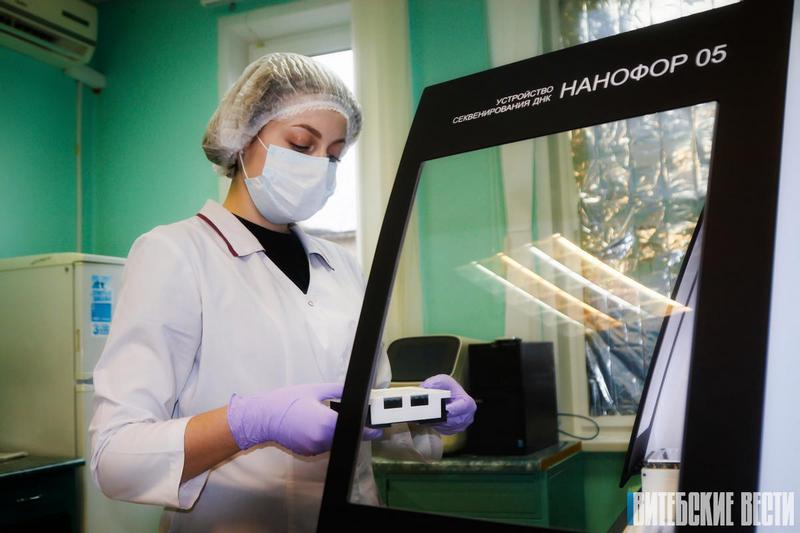

Figure: The same model in the Vitebsk oblast laboratory, published February 3, 2025, with its badge legible: «УСТРОЙСТВО СЕКВЕНИРОВАНИЯ ДНК · НАНОФОР 05».

*Image source: Vitebskie Vesti · republished at sudexpert.gov.by*

### The local tier is thin but real

Belarusian production splits in two. State-program work with the [Institute of Bioorganic Chemistry of the NAS](https://www.hopiboh.org/), under *«Наукоемкие технологии и техника» 2016–2020*, produced domestic forensic reagents — but for **animal** (poaching) and **plant** (cannabis) identification, not human ID. The genuine human-ID capability sits with [**Algimed Techno**](https://algimed.com/), a Russian–Belarusian joint venture in Minsk, whose ALSENSE Forensic and Alprep Forensic Auto products cover quantification and extraction. No Belarusian-made human STR amplification kit was found.

> **What substitution does and does not resolve for Western vendors**
>
> It reduces *future* exposure: new Belarusian capacity is being built on Russian and Chinese product. It does not retire the legacy. The register that RFE/RL describes contains profiles generated on Western platforms, and those profiles do not expire when a supplier leaves the market.

*Method*

## 10. Evidence limits

The state tender portal icetrade.by was searched systematically — its tender archive and its separate contract registry, both filtered to the SFEC and its Scientific-Practical Center — for every vendor, kit, and instrument name in this report. 114 tenders (2013–2020) and 63 contracts were confirmed genuinely forensic-DNA-relevant and reviewed individually; see the callouts added throughout this report and the (confidence: [verified](https://icetrade.by/) — verified against multiple independent high-quality sources) finding below. The access barrier described in the original version of this section (HTTP 403 from outside Belarus, reproduced across five paths) was real at the time and is left below for the record, but no longer holds.

> **What icetrade.by adds, and what it still cannot answer**
>
> The tender archive puts brand names directly into SFEC lot tables — a QIAGEN Argus X-12 matrix standard, Promega PowerPlex matrix standards, and Thermo Fisher GlobalFiler/Identifiler kits in the same 2015 tender (confidence: [sourced](https://icetrade.by/tenders/all/view/224373) — a single identifiable source) — and 2014 equipment-repair tenders confirm a QIAGEN BioRobot Universal, an Applied Biosystems 3100 analyzer, and Thermo Fisher lab hardware already installed and in service. (confidence: [sourced](https://icetrade.by/tenders/all/view/152886) — a single identifiable source) The separate contract registry, which uniquely names winning suppliers and declared countries of origin, adds two kinds of evidence predating the war. The first is non-Western supply: a Russian sole-source Taq-polymerase purchase (Sintol, 2017). (confidence: [sourced](https://icetrade.by/tenders8000/view/434747) — a single identifiable source) The second is Western instruments bought through non-Western intermediaries: an Illumina MiSeq FGx sold to the Scientific-Practical Center by a Moscow reseller (Альбиоген, September 26, 2018) (confidence: [sourced](https://icetrade.by/tenders8000/view/844543) — a single identifiable source), and a Thermo Fisher Ion GeneStudio S5, with Precision ID ancestry and DNA-phenotyping panels, sold to the committee’s central office by a Minsk reseller (Спектртрэйдинг, November 2, 2018). (confidence: [sourced](https://icetrade.by/tenders8000/view/885046) — a single identifiable source)
>
> Both icetrade.by data sources independently go silent for the SFEC at almost the same date: the tender archive’s last DNA-relevant entry is November 17, 2020, the contract registry’s is October 5, 2020. Every SFEC tender posted after that date, through March 2026, is for construction, IT equipment, or office supplies — none for reagents, analyzers, or sequencing. This appears to coincide with a roughly eight-fold, *platform-wide* collapse in Belarusian contract-disclosure volume beginning the same winter, not something unique to SFEC or to DNA identification — but either way, **icetrade.by has nothing to say, one way or the other, about supply during the 2022–present sanctions period**, since its trail for this purchaser stops well before the war starts. (confidence: inferred — strong — derived by reasoning)
>
> One tension the new evidence raises rather than resolves: the Scientific-Practical Center tried three times to buy the specific ForenSeq and MiSeq FGx consumables named in the Kotova 2023 paper (below), **and failed each time**. Those lots failed in a 2019 tender that did produce contracts for general-purpose Illumina Nextera XT library-prep kits, and every lot was declared failed in a July 2020 tender and its August repeat. The records do not say why: no bids, a single bid, and rejected bids all end in the same status. How the specific ForenSeq chemistry documented in casework by 2023 was actually obtained — a successful purchase outside this search’s date range or search terms, the June 2021 Verogen distribution agreement, or some other channel — is not resolved by this research. (confidence: unverified — not confirmable from available sources)

Other specific limits:

- An Applied Biosystems analyzer is documented in service as recently as August 19, 2026, from the committee’s own photograph; the maker’s mark is legible and the model number is not. Whether the MiSeq FGx remains in service is unknown; nothing was found either way.
- The Chinese supplier behind the 2017 cost-cutting announcement is identified in (see section: chinese) as FISCAN, from the committee’s own 2016 photograph of a badged GA118 — but no evidence was found that the purchase completed.
- Two population studies by Rębała and colleagues, from 2007 and 2015, are not used as evidence that a kit was run in Belarus. Their first and last authors are at the Medical University of Gdańsk, and the 2007 study’s proficiency testing was that of the Polish Society of Forensic Medicine and Criminology, which suggests the typing was done in Poland; the 2015 study does not settle where. Identifiler rests instead on the SFEC’s own casework papers and its 2015 tender, and Investigator Argus X-12 on that tender, which sought the kit’s matrix standard.
- The published record ends around 2023. Anything asserted about 2024–2026 rests on SFEC public statements and vendor catalogs, not on laboratory documentation — icetrade.by’s own disclosure gap means it cannot fill this in.

Nothing in this assessment alleges unlawful conduct by any company named. It describes documented technology presence, dated corporate positions, and the risk channels that remain open where the record goes dark.

> **Principal sources — links checked on their respective dates; the Chinese-channel sources added September 25, 2026**
>
> 1.  [RFE/RL, “Belarusian State Quietly Builds Dissident DNA Database”](https://www.rferl.org/a/belarus-dna-law-mandatory-saliva-dissident/33842635.html), August 29, 2026; [Viasna](https://spring96.org/en/news/118462), collection of DNA from relatives of exiles, Mahilioŭ region (link status: Viasna blocks automated checks; opens in a browser)
>
> 2.  Kotova S.A. et al., “Полиморфизм 27 аутосомных STR-локусов…”, *Генетика* 59(3):356–366, 2023 — [doi:10.1134/S1022795423030079](https://doi.org/10.1134/S1022795423030079), [Russian full text](https://sciencejournals.ru/view-article/?j=genrus&y=2023&v=59&n=3&a=GenRus2303007Kotova). Methods name ForenSeq DNA Signature Prep (Verogen), MiSeq FGx and ForenSeq UAS (Illumina), PowerPlex Fusion 6C and Quantus (Promega), AB3500 and GeneMapper ID-X 1.4 (Thermo Fisher).
>
> 3.  Borovko S., Shyla A., Korban V., Borovko A., “Amelogenin test abnormalities revealed in Belarusian population during forensic DNA analysis”, *FSI: Genetics* 15:98–104, 2015 — [doi:10.1016/j.fsigen.2014.10.014](https://doi.org/10.1016/j.fsigen.2014.10.014), [PubMed 25458925](https://pubmed.ncbi.nlm.nih.gov/25458925/), [authors’ slide deck with the full kit and instrument list](https://www.slideshare.net/AlenaShyla/amelogenin-test-abnormalities-revealed-in-belaruisan-population-during-forensic-dna-analysis-43731454).
>
> 4.  Zhivotovsky L.A. et al., “A reference data base on STR allele frequencies in the Belarus population developed from paternity cases”, *FSI: Genetics*, 2009 — [doi:10.1016/j.fsigen.2008.10.003](https://doi.org/10.1016/j.fsigen.2008.10.003). Tsybovsky I.S. et al., 18-STR national reference database, 2017 — [doi:10.1134/S1022795417020132](https://doi.org/10.1134/S1022795417020132), [PubMed 29372974](https://pubmed.ncbi.nlm.nih.gov/29372974/).
>
> 5.  Kotova S.A., Rybakova V.I., Zabavskaya T.N., et al., “Polymorphism of X-chromosome microsatellite loci of ethnic Belarusians in the context of the forensic personality identification,” *Doklady of the National Academy of Sciences of Belarus* 60(2):78–84, 2016 — [doklady.belnauka.by](https://doklady.belnauka.by/jour/article/view/39/0?locale=en_US). A population study of 19 X-STRs led from the SFEC’s Scientific-Practical Center; its abstract names no kit, and no full text was found.
>
> 6.  SFEC, [*Реестр методических материалов в сфере судебно-экспертной деятельности*](https://sudexpert.gov.by/%D0%A0%D0%B5%D0%B5%D1%81%D1%82%D1%80%20%D0%BC%D0%B5%D1%82%D0%BE%D0%B4%20%D0%BC%D0%B0%D1%82%D0%B5%D1%80%D0%B8%D0%B0%D0%BB%D0%BE%D0%B2%20%D0%B2%20%D1%81%D1%84%D0%B5%D1%80%D0%B5%20%D0%A1%D0%AD%D0%94%20140721.pdf), version July 14, 2021 — QIAamp DNA Investigator Kit (QIAGEN); StockMarks cat. 4307481 (Thermo Fisher); COrDIS Horse and Cattle (Гордиз, RF).
>
> 7.  [QIAGEN N.V., 2022 IFRS Annual Report (PDF)](https://corporate.qiagen.com/files/doc_downloads/other_reports/2022-IFRS-Annual-Report.pdf); [completion of the Verogen acquisition, January 3, 2023](https://corporate.qiagen.com/English/newsroom/press-releases/press-release-details/2023/QIAGEN-Completes-Acquisition-of-Verogen-Strengthening-Leadership-in-Human-ID--Forensics-With-NGS-Technologies/default.aspx); [MiSeq FGx product page, “Verogen — a QIAGEN company”](https://verogen.com/products/miseq-fgx-sequencing-system/).
>
> 8.  [Thermo Fisher Scientific corporate position as recorded by the \#LeaveRussia tracker](https://leave-russia.org/thermo-fisher-scientific): operations paused March 2022, sales and manufacturing ceased in Russia and Belarus, entity liquidated December 2023.
>
> 9.  SFEC: [purchase of Chinese equipment, November 23, 2017](https://sudexpert.gov.by/en/list_news_occurrence_n.html?news_id=3765); [distributor agreements with Gordiz and NPF Syntol, October 20–21, 2022](https://sudexpert.gov.by/ru/list_news-bseo-a-n.html?news_id=9336); [Moscow talks on Nanophor-05, Colibri МВ-5-96, and Nanophor SPS, November 29, 2024](https://sudexpert.gov.by/ru/bseo-news.html?news_id=12288); [Gomel oblast fee schedule, February 12, 2026](https://ggkp4.by/ekspertizy-provodimye-na-platnoj-osnove-v-upravlenii-gosudarstvennogo-komiteta-sudebnyh-ekspertiz-respubliki-belarus-po-gomelskoj-oblasti/).
>
> 10. [RUP «Белсудэкспертобеспечение»](https://sudexpert.gov.by/ru/bseo-info.html) and its commercial site [belsudmed.by](https://belsudmed.by/reagentu/laboratornoe-oborudovanie); [NPF Syntol Gene Profile Human, 28 STR loci](https://lab.scienceid.net/catalog/9824/28772/) and [НАНОФОР-05](https://lab.scienceid.net/catalog/9824/26514/) (link status: syntol.ru itself is unreachable from outside the region); [Gordiz COrDIS Plus](https://gordiz.ru/en/products/dna-hid/cordis-plus/); [Algimed Techno ALSENSE Forensic](https://algimed.com/katalog/chemicals_and_kits/molekulyarnaya-biologiya/mb-ptsr/algimed-techno-alsense-forensic.html) and [Alprep Forensic Auto](https://www.dia-m.ru/catalog/reactive/nabory-dlya-sme-i-ekts/nabory-dlya-vydeleniya-nukleinovykh-kislot/nabor-reagentov-dlya-avtomatizirovannogo-vydeleniya-dnk-iz-biologicheskikh-obraztsov-alprep-forensic/).
>
> 11. [Council of the EU, sanctions against Belarus](https://www.consilium.europa.eu/en/policies/sanctions-against-belarus/) (consolidated list not verified for the SFEC) (link status: blocks automated checks; opens in a browser); [US BIS, imposition of sanctions against Belarus under the EAR, March 2022](https://www.federalregister.gov/documents/2022/03/08/2022-04819/imposition-of-sanctions-against-belarus-under-the-export-administration-regulations-ear).
>
> 12. **icetrade.by, added September 11, 2026.** Tender archive: [2015-224373](https://icetrade.by/tenders/all/view/224373) and [2015-263728](https://icetrade.by/tenders/all/view/263728) (QIAGEN Argus X-12, Promega PowerPlex, Thermo Fisher GlobalFiler/Identifiler in one lot table); [2014-152886](https://icetrade.by/tenders/all/view/152886) and [2014-163710](https://icetrade.by/tenders/all/view/163710) (QIAGEN BioRobot Universal, AB 3100, Thermo Fisher equipment — maintenance contracts implying a pre-2014 installed base); [2019-699701](https://icetrade.by/tenders/all/view/699701) (Nextera XT lots signed; ForenSeq/MiSeq FGx lots failed); [2020-823410](https://icetrade.by/tenders/all/view/823410) and [2020-830011](https://icetrade.by/tenders/all/view/830011) (ForenSeq/MiSeq FGx tenders, both fully unsuccessful); [2020-814713](https://icetrade.by/tenders/all/view/814713) and [2020-841738](https://icetrade.by/tenders/all/view/841738) (outsourced whole-genome human DNA sequencing, 60 samples); [2020-852978](https://icetrade.by/tenders/all/view/852978) (last DNA-relevant tender-archive entry, Nov. 17, 2020). Contract registry (`tenders8000`): [contract 885046](https://icetrade.by/tenders8000/view/885046) and [844543](https://icetrade.by/tenders8000/view/844543) (two high-throughput sequencing platforms, autumn 2018, Belarusian and Russian resellers respectively); [434747](https://icetrade.by/tenders8000/view/434747) (Sintol Taq polymerase, sole-source, 2017); [1239262](https://icetrade.by/tenders8000/view/1239262) (last DNA-relevant contract-registry entry, Oct. 5, 2020). (link status: icetrade.by refused a direct connection; reached via a Russian-registered address)
>
> 13. **The Chinese channel, added September 25, 2026.** FISCAN corporate news naming Belarus among the countries whose DNA laboratories run its GA118 analyzers, September 29, 2022 — [fiscan.cn/news/show-49.html](https://www.fiscan.cn/news/show-49.html); the FISCAN product line — [fiscan.cn](https://www.fiscan.cn/product/list-409.html); the syndicated “Beijing Express” segment — [Sohu](https://www.sohu.com/a/543029162_120449597) and [Baijiahao](https://baijiahao.baidu.com/s?id=1731626723630151664&wfr=spider&for=pc).
>
> 14. State Forensic Examination Committee, November 1, 2016 — “Belarus and China are interested in cooperation in the field of forensic activities”: the MPS forensic delegation’s visit, the «Human and Security» exhibition, the demonstrated Chinese genetic analyzer badged GA118, and the cost comparison, with four committee photographs — [sudexpert.gov.by](https://sudexpert.gov.by/en/list_news_occurrence_n.html?news_id=2550)
>
> 15. State Forensic Examination Committee, August 27, 2019 — the MPS seminar at the Central Office and the reagent testing at «Белсудэкспертобеспечение», which also recounts the June 2016 visit and the 2018 cooperation agreement — [sudexpert.gov.by](https://sudexpert.gov.by/en/list_news_occurrence_n.html?news_id=6485); BelTA, April 13, 2018, chairman Andrei Shved on arrangements to acquire Chinese genetic-fingerprinting equipment — [eng.belta.by](https://eng.belta.by/society/view/belarus-considers-purchasing-dna-testing-equipment-from-china-110942-2018/)
>
> 16. State Forensic Examination Committee, March 11, 2019 — a *Komsomolskaya Pravda* report republished on the committee’s Central Apparatus news page, showing an Applied Biosystems 3500xL in use — [sudexpert.gov.by](https://sudexpert.gov.by/ru/centr-news.html?news_id=6021); the same model in the committee’s own photograph illustrating an explainer republished February 28, 2020 — [zorkanews.by](https://zorkanews.by/28022020/chto-takoe-geneticheskaya-ekspertiza-i-d/), image at [sudexpert.gov.by](https://sudexpert.gov.by/Genom/genomsample06.jpg)
>
> 17. Regional and later instrument photography — Grodno oblast directorate, January 31, 2022 — [sudexpert.gov.by](https://sudexpert.gov.by/ru/list_news_occurrence_n.html?news_id=8451); Vitebsk oblast directorate, August 24, 2022 — [sudexpert.gov.by](https://sudexpert.gov.by/ru/list_news_occurrence_n.html?news_id=9140); an Applied Biosystems analyzer still in service, August 19, 2026 — [sudexpert.gov.by](https://sudexpert.gov.by/ru/list_news_occurrence_n.html?news_id=15317)
>
> 18. The Russian platform — Белсудэкспертобеспечение certified to service the «Нанофор 05», November 3, 2023 — [sudexpert.gov.by](https://sudexpert.gov.by/ru/list_news-bseo-a-n.html?news_id=10615); the April 2024 expert training seminar — [sudexpert.gov.by](https://sudexpert.gov.by/ru/list_news-bseo-a-n.html?news_id=11215); the November 2024 Moscow talks — [sudexpert.gov.by](https://sudexpert.gov.by/ru/bseo-news.html?news_id=12288); a Nanofor-form instrument during an August 2023 visit — [sudexpert.gov.by](https://sudexpert.gov.by/ru/list_news_occurrence_n.html?news_id=10326); two more in a BelTA report of October 26, 2025 — [belta.by](https://belta.by/society/view/proverili-biomaterial-bolee-40-tys-chelovek-kak-eksperty-vychislili-genotip-mogilevskogo-manjjaka-745168-2025/)
>
> 19. The Russian branch shown to the Belarusian service — Белсудэкспертобеспечение at Analitika Expo 2023 — [belsudmed.by](https://belsudmed.by/news/direktor-posetil-vystavku) (link status: reachable only from some networks); the committee’s own photograph of the G-series analyzer — [sudexpert.gov.by](https://sudexpert.gov.by/7gfshjsgrhsfhf.jpg); Ningbo Health Gene Technologies’ SureID product index — [healthgenetech.net](https://www.healthgenetech.net/product/index.html)
>
> 20. The Chinese counterpart — Entity List addition of the MPS Institute of Forensic Science with its two aliases, *Federal Register* 85 FR 34503, June 5, 2020 — [govinfo.gov](https://www.govinfo.gov/content/pkg/FR-2020-06-05/html/2020-10868.htm); removal, November 17, 2023 — [govinfo.gov](https://www.govinfo.gov/content/pkg/FR-2023-11-17/html/2023-25557.htm); the 2022 rename — [baike.baidu.com](https://baike.baidu.com/en/item/Ministry%20of%20Public%20Security%20Identification%20Center/36766); the Ministry of Justice’s separate Academy of Forensic Science — [tandfonline.com](https://www.tandfonline.com/doi/full/10.1080/20961790.2021.1912877); later visits on the committee’s Instagram account, [June 2025](https://www.instagram.com/sudexpert_by/p/DK2fvOXonQq/?img_index=5) and [October 2025](https://www.instagram.com/p/DPWYDydDANi/?img_index=9)
>
> 21. **Committee photography of instruments in the oblast laboratories, added September 27, 2026.** Grodno oblast directorate, August 1, 2018, the **3500** with its model legible on the front plate — [sudexpert.gov.by](https://sudexpert.gov.by/ru/grodno-news.html?news_id=5225). «НАНОФОР 05» with the badge legible: Vitebsk, February 3, 2025 — [sudexpert.gov.by](https://sudexpert.gov.by/ru/vitebsk-news.html?news_id=12521); Minsk oblast, April 1, 2025 — [sudexpert.gov.by](https://sudexpert.gov.by/ru/list_news-minsk-a-n.html?news_id=12773); Gomel, September 3, 2025 — [sudexpert.gov.by](https://sudexpert.gov.by/ru/gomel-news.html?news_id=13517); Minsk oblast, March 24, 2026 — [sudexpert.gov.by](https://sudexpert.gov.by/special/ru/minsk-news.html?news_id=14499). These are human-interest features rather than procurement records, so each date is a publication date and bounds nothing about when an instrument arrived. (link status: four of the five hold no Wayback snapshot)
>
> 22. **GTZ / Gera Health, checked September 29, 2026.** SureID identification-kit catalog, naming the PanGlobal/27comp/S6/S7/43G line and claiming Russian manufacture at Skolkovo — [gtz-rus.ru](https://gtz-rus.ru/Identification-kits); the sibling storefront sharing GTZ’s contact address and copyright line — [gera.health](https://gera.health/catalog?tfc_storepartuid%5B1570472791%5D=%D0%A0%D0%B5%D0%B0%D0%B3%D0%B5%D0%BD%D1%82%D1%8B,+%D0%BD%D0%B0%D0%B1%D0%BE%D1%80%D1%8B&tfc_div=); Белсудэкспертобеспечение’s own laboratory-equipment catalog page, naming Gordiz and Syntol and no SureID — [belsudmed.by](https://belsudmed.by/reagentu/laboratornoe-oborudovanie).
>
> 23. **The September 2026 tender and the FGI sequencing platform, added September 29, 2026.** Auction documents for tender 3706701, signed September 28, 2026, eight lots — [xtenders.by](https://xtenders.by/tenders/3706701) (link status: free account required; the free view shows seven lots; the documents are archived); the validation study of the FGID Four-in-One kit on the DNBSEQ-G99RS, *Forensic Sciences Research*, 2024 — [PMC12224613](https://pmc.ncbi.nlm.nih.gov/articles/PMC12224613/); FGI’s sanctions record, listing BGI Forensic Technology (Shenzhen) as an alias — [opensanctions.org](https://www.opensanctions.org/entities/NK-BqY2z8HLUXD7YEzNJGDqw6/); the Entity List addition, effective March 2, 2023, and published March 6 — [govinfo.gov](https://www.govinfo.gov/content/pkg/FR-2023-03-06/html/2023-04558.htm); the Section 1260H notices naming FGI and MGI Tech, [January 2025](https://www.govinfo.gov/content/pkg/FR-2025-01-07/html/2025-00070.htm) and [June 2026](https://www.govinfo.gov/content/pkg/FR-2026-06-10/html/2026-11571.htm); MGI Tech’s addition to the UFLPA Entity List, October 29, 2026 — [dhs.gov](https://www.dhs.gov/uflpa-entity-list).
>
> 24. Companion report — [*Genealogy of a Genetic Surveillance Platform: The GA118 Genetic Analyzer*](https://otlet.tech/advocacy/reports/ga118-genealogy/), which sets out the device lineage, the rebranding chain, and the conflicting manufacturer attributions summarized in (see section: chinese).
