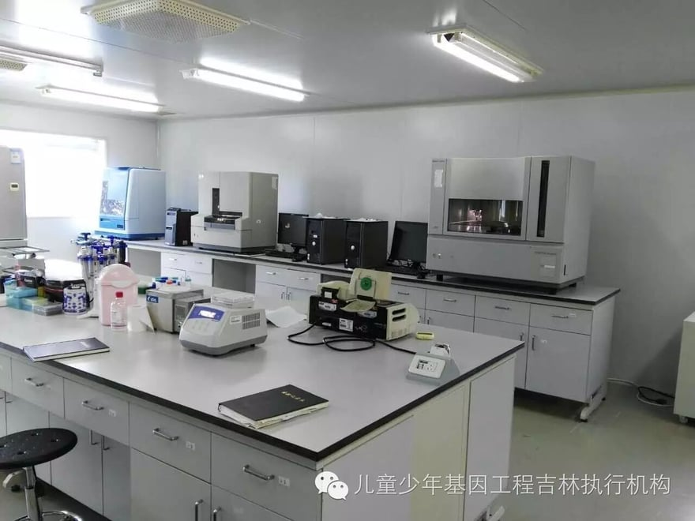
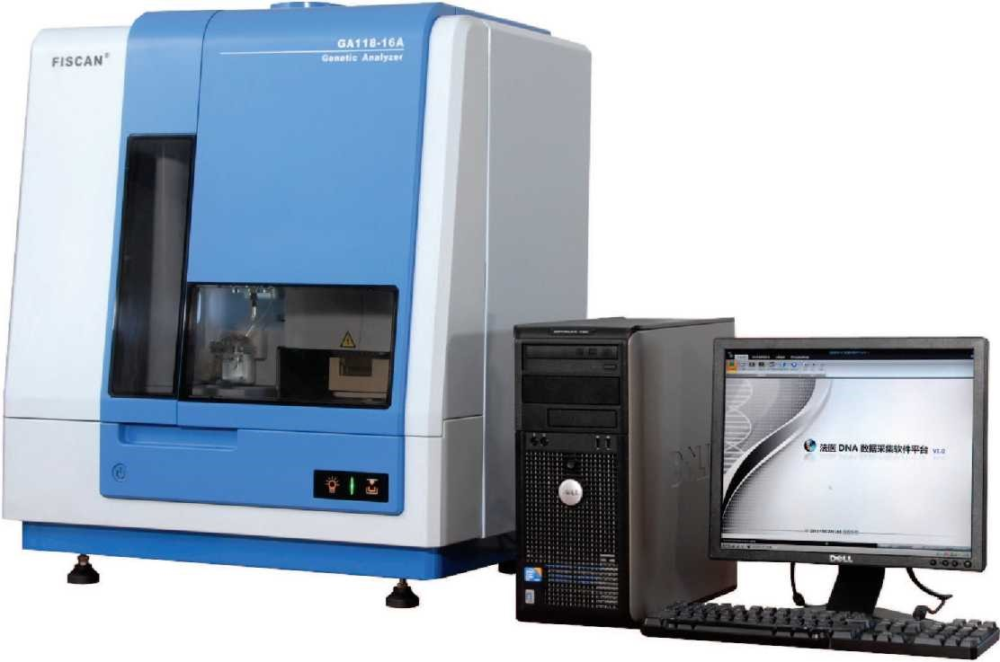
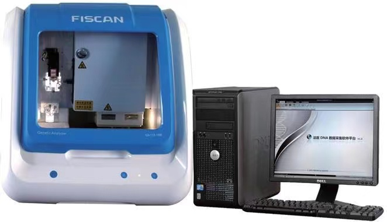
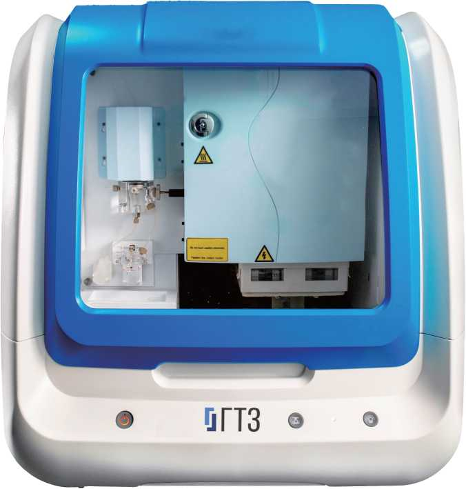
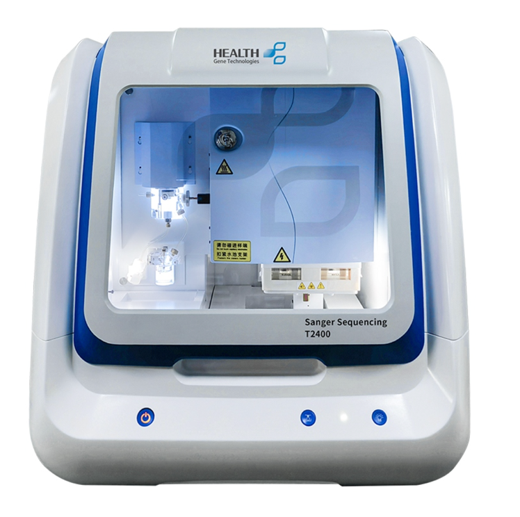
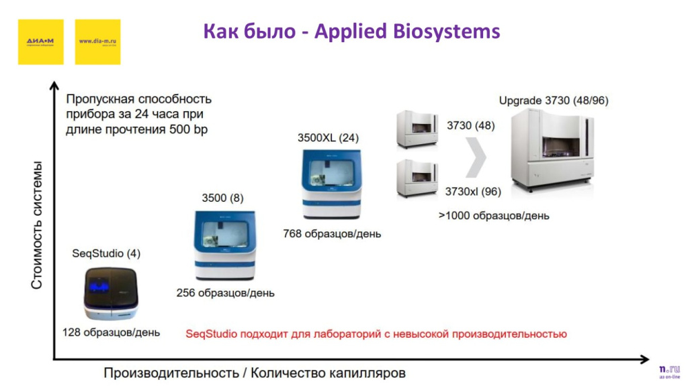
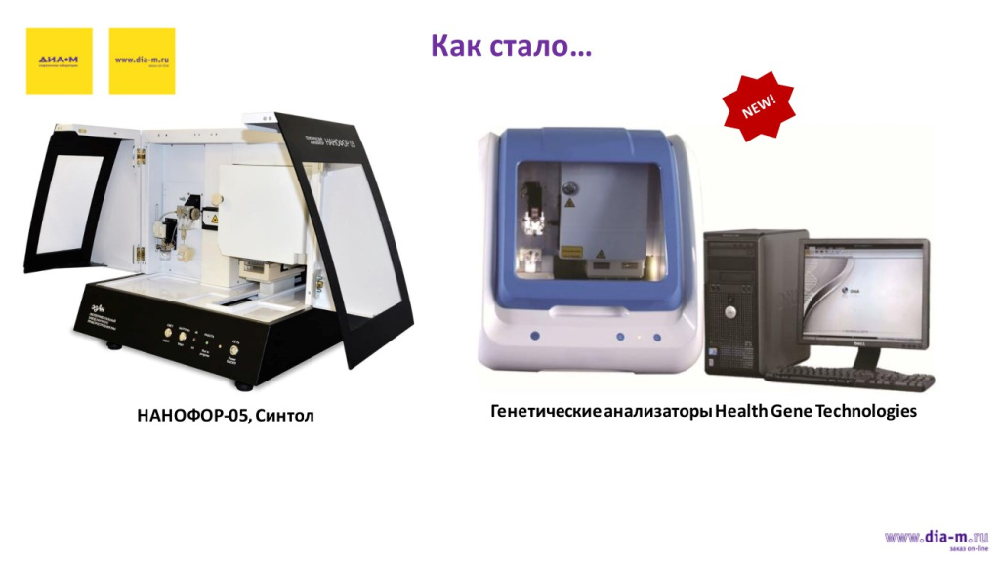
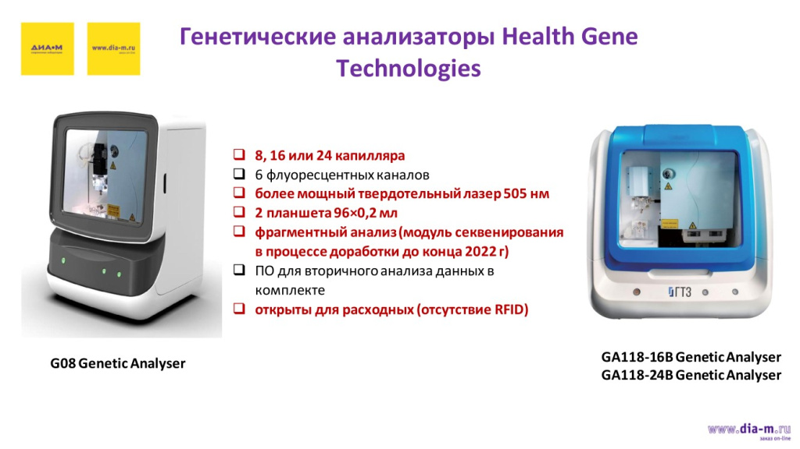

# Genealogy of a Genetic Surveillance Platform: The GA118 Genetic Analyzer

A Chinese capillary electrophoresis sequencer line, initially developed inside the Ministry of Public Security’s research apparatus, has tracked Thermo Fisher’s Applied Biosystems analyzers across two hardware generations — and the same chassis resurfaces under at least four further entities, one of them on a US Entity List for conduct linked to surveillance-related human-rights abuses in Xinjiang. This report documents the device lineage, the rebranding chain, and what the conflicting manufacturer attributions do and do not settle.

- Author: Yves Moreau

- Organization: OTLET · Own The Limits · Ethics in Tech · otlet.tech

- Published: November 17, 2026

- Subject: GA118 genetic analyzer · ГТЗ/GTZ G08/G016/G24 genetic analyzer · T2400/CE2400 genetic analyzer · FISCAN / Beijing Zhongdun Anmin, CN · 中盾安民 · Ningbo Health Gene Technologies, CN · Hangzhou Jiusheng Biotech, CN · GTZ / ГТЗ / Gera Health, RU

- Method: Open-source research on corporate and institutional publications, product photography, a Russian medical-device regulatory filing, and a peer-reviewed validation study

- Cite as: Moreau Y. *Genealogy of a Genetic Surveillance Platform: The GA118 Genetic Analyzer*. OTLET. Nov 2026. [doi:10.5281/zenodo.24322804](https://doi.org/10.5281/zenodo.24322804)

- Sources: <https://doi.org/10.5281/zenodo.24322419>

> Compiled from open sources. This document supplements the report [*Belarus’s National DNA Database: Who Built It, and Who Still Supplies It*](https://otlet.tech/advocacy/reports/belarus-dna-database/) to document the lineage of the GA118 sequencers. Nothing in the present document alleges unlawful conduct by any company named beyond what is explicitly attributed to a named regulator or publication. Every URL and every factual claim carries an implicit verify-before-use caveat. We acknowledge mistakes in our reports with corrections. If you spot an error, please let us know at info@otlet.tech.

------------------------------------------------------------------------

> Creative Commons [CC-BY 4.0](https://creativecommons.org/licenses/by/4.0/) license (except institutional logo and third-party material (citations and photographs)). Free to reuse with attribution. AI-assisted information collection, analysis, and drafting. Research design, direction, supervision, and line-by-line review by the author.
>
> A note on sourcing: every load-bearing claim carries a confidence tag, on one scale. (confidence: verified — verified against multiple independent high-quality sources) — corroborated by multiple independent high-quality sources. (confidence: sourced — a single identifiable source) — one identifiable source, named at the point the claim is made. (confidence: inferred — derived by reasoning) — derived by reasoning from the evidence, with the strength of the inference stated. (confidence: unverified — not confirmable from available sources) — could not be confirmed from the sources available; the text says what was checked and what came back empty. Where an instrument is identified from a photograph, the report says whether the badge was legible or the identification rests on chassis recognition. All external links were checked on their respective dates. Some links may not be reachable from servers outside their country. An archive of the cited sources is linked for download, except for academic publications, which may require a subscription.

> **What this document is, and what it is for**
>
> This is a technical annex. It establishes what the GA118 hardware platform is — how it tracks the Applied Biosystems line, and how many commercial identities it wears — without arguing anything about Belarus. The Belarusian deployment record, including the 2016 demonstration in Minsk, the intent to buy announced in 2017, and the manufacturer’s 2022 claim, is set out in the main report, *Belarus’s National DNA Database: Who Built It, and Who Still Supplies It*.

*Hardware & software convergence*

## 1. GA118 and the ABI platforms

FISCAN’s GA118 series — developed by **Beijing Zhongdun Anmin Analysis Technology Co., Ltd.** ([中盾安民](https://www.fiscan.cn/product/list-409.html)), a subsidiary of the Ministry of Public Security’s First Research Institute — shows a consistent pattern of hardware and software convergence with Thermo Fisher’s Applied Biosystems capillary-electrophoresis genetic analyzers (ABI3130/ABI3500), tracking two successive ABI generations rather than one.

### Generational tracking

| Parameter | GA118-16A (earliest, ~2010) | GA118-16B / 24B (later) | ABI comparator |
|----|----|----|----|
| Laser | Argon-ion gas, 488 & 514.5 nm, ≤25 mW | Solid-state, single-line, 505 nm | 3100/3130: argon-ion 488/514.5 nm → 3500: solid-state 505 nm |
| Dye channels | 5–6 color | Up to 8 color | 3500: up to 6 color |
| Voltage range | −20 kV to 0 kV | −20 kV to 0 kV | 3500: up to 20 kV |
| Fluorescence range | 522–650 nm | 522–650 nm | — |
| Polymer | Domestic Typer15; POP-4, POP-7 supported | POP-4, POP-7, domestic polymer; open platform | POP-4, POP-6, POP-7 (proprietary) |
| Sample format | 96-well ×2, auto-injection | 96-well ×2, auto-injection | 96-/384-well, auto-injection |
| Capillary counts | 16 | 16 / 24 / 48 | 8 (3500) / 24 (3500xL) |

GA118 hardware evolution against the ABI comparator it tracks

*Sources: [touyuli.com GA118-16A spec sheet](http://touyuli.com/en/pd.jsp?id=1) · [fgidna.com GA118 solutions page](https://e.fgidna.com/solutions?id=37) · [Thermo Fisher 3500/3500xL specification sheet](https://documents.thermofisher.com/TFS-Assets/LSG/Specification-Sheets/3500-Genetic-Analyzer-Specification-Sheet.pdf).*

The shift from an argon-ion 488/514.5 nm gas laser (GA118-16A) to a solid-state 505 nm laser (GA118-16B/24B) mirrors ABI’s own transition from the 310/3100/3130 generation to the 3500 generation. This is a more specific pattern than a single-model comparison: FISCAN’s hardware generations tracked ABI’s laser technology step by step across *two* separate ABI product generations, not a one-time convergence. (confidence: inferred — strong — derived by reasoning)

### Software interoperability

FISCAN’s own analysis software, **GAMarker**, is documented as supporting output file formats from ABI3100, ABI3130, and ABI3500 — explicit interoperability with exactly the two ABI hardware generations the GA118 line’s own laser evolution tracked. (confidence: [sourced](http://www.xsjs-cifs.com/article/2021/1008-3650-46-5-449.html) — a single identifiable source) · *Source: 刑事技术, GAMarker design paper*

### Independent validation against the ABI 3500

> **Translation:** A peer-reviewed validation study — Qu et al., “Internal validation of the GA118-24B Genetic Analyzer, a stable capillary electrophoresis system for forensic DNA identification,” *Int J Legal Med* 138(2):361–373, 2024 — co-authored by staff of the Ministry of Public Security’s First Research Institute and Central South University, benchmarked the GA118-24B directly against the ABI 3500 using three commercial STR kits, reporting acceptable spectral calibration, sub-0.1 bp precision, and sensitivity/mixture performance matching the 3500 in parallel runs.
>
> — Qu et al. 2024 · doi:10.1007/s00414-023-03106-x (confidence: [sourced](https://pubmed.ncbi.nlm.nih.gov/37843624/) — a single identifiable source)

### Photographic evidence: side-by-side deployment

A DNA laboratory bench, watermarked to the WeChat account “儿童少年基因工程吉林执行机构” (Children/Youth Gene Project — Jilin Executive Agency), shows an early-generation FISCAN unit alongside what appear visually to be an ABI 3130(xl) and an ABI 3730(xl) genetic analyzer. (confidence: attributed, single source, visual comparison — derived by reasoning)

Figure: DNA laboratory bench pictured with an early-generation FISCAN unit and two further capillary electrophoresis instruments.

*Image source: WeChat · 儿童少年基因工程吉林执行机构*

Figure: FISCAN GA118-16A, official product photography, shown for reference against the photograph above. [Reseller product listing](http://touyuli.com/en/pd.jsp?id=1).

*Image source: touyuli.com / fgidna.com product listings*

*Three further brands*

## 2. Repackaging and redistribution

The GA118 hardware lineage appears under at least three additional commercial identities. The strength of documentation differs sharply across the three, and is stated accordingly below.

### FGI (Forensic Genomics International) GA118 — confirmed subsidiary of BGI

> **Translation:** “Forensic Genomics International (FGI), a subsidiary of BGI, one of the world’s largest genomics organization…” — FGI’s own site lists the GA118 Forensic Genetic Analyser directly in its own solutions menu, alongside its NGS and DNBSEQ product lines.
>
> — FGI, “About” page, e.fgidna.com (confidence: [sourced](https://e.fgidna.com/about) — a single identifiable source)

> **FGI is on the US Entity List and the Section 1260H list**
>
> On **March 2, 2023**, the US Department of Commerce’s Bureau of Industry and Security added Forensic Genomics International to the Entity List by name, alongside BGI Research and BGI Tech Solutions (Hong Kong), citing risk of “contributing to monitoring and surveillance by the government of China” that has been “utilized in the repression of ethnic minorities in China,” and a significant risk of diversion to China’s military programs. (confidence: sourced — a single identifiable source)
>
> The Department of Defense separately designates FGI a **Chinese military company** under Section 1260H of the FY2021 National Defense Authorization Act, listed as a subsidiary of BGI Group in its January 2025 and June 2026 notices. The June 2026 notice describes BGI Group as affiliated with the People’s Liberation Army and as a “military-civil fusion contributor to the Chinese defense industrial base.” MGI Tech, BGI’s sequencing-instrument maker, is listed in both notices in its own right. (confidence: [verified — the Federal Register notices of January 7, 2025, and June 10, 2026](https://www.govinfo.gov/content/pkg/FR-2026-06-10/html/2026-11571.htm) — verified against multiple independent high-quality sources)
>
> This does not, on its own, establish that GA118 units distributed by FGI reached Belarus specifically — but it means the GA118 hardware documented in Belarusian use in the main report is also distributed, by an entity the US government has formally linked to human-rights-abusive surveillance conduct elsewhere, next to the DNBSEQ next-generation sequencing hardware distributed by FGI Tech.

*Source: [Ropes & Gray, summary of the BIS designation.](https://www.ropesgray.com/en/insights/alerts/2023/04/bis-imposes-export-restrictions-on-bgi-group-the-worlds-largest-genomics-company)*

Figure: FISCAN-branded GA118-16B unit, official product photography. [FGI GA118 solutions page](https://e.fgidna.com/solutions?id=37).

*Image source: fgidna.com / manufacturer materials*

### Gera Health / «ГТЗ» (Russia) G08 — same machine, corporate relationship not established

The clearest account of this branch is the distributor’s own. A Moscow company [ООО «Генные Технологии Здоровья»](https://gtz-rus.ru/), also trading as [**Gera Health**](https://gera.health) sells a «Генетический секвенатор (анализатор) **ГТЗ G08**» and describes it on its product page as one of the «генетический анализатор **серии G**» — the G-series designation that appears on the Russian registration certificate. The page states the manufacturer outright and cites the certificate by number. (confidence: [sourced — first-party](https://gera.health/genetic-laboratory/tproduct/547632153932-geneticheskii-sekvenator-analizator-gtz) — a single identifiable source)

- **Manufacturer: Hangzhou Jiusheng Biotech Co., Ltd** — a third entity, distinct from both FISCAN/Ministry of Public Security and from Ningbo Health Gene Technologies.
- **№РЗН 2024\22415** — the distributor cites the same Roszdravnadzor certificate examined below, tying the retail product to the regulatory filing without any inference on this report’s part.
- The published specification is the GA118’s: a new-type solid-state **505 nm** laser, fluorescence detection **522–650 nm**, **0–20 kV**, two 96-well plates loadable at once, P4 and P7 polymers, an **open** system, and output in **.fsa/.abi** — the Applied Biosystems formats. Eight capillaries, 610×710×820 mm, 105 kg.
- Генные Технологии Здоровья is plausibly a Russian rendering of “Health Gene Technologies” (with the word order reversed). (confidence: inferred — strong on the linguistic match; not confirmed as an official rebranding — derived by reasoning)

*Sources: [Gera Health, ГТЗ G08 product page](https://gera.health/genetic-laboratory/tproduct/547632153932-geneticheskii-sekvenator-analizator-gtz).*

![The ГТЗ G08 as its Russian distributor pictures it: the moulded white shell with curved shoulders, the recessed front handle, the square window, three round controls across the fascia, and inside, the injection assembly, the circular valve, and the yellow hazard labels in the positions they occupy on the FISCAN unit. It is badged G08 at the window and «ГТЗ» below. The interior warning label is in English only, where the unit photographed in Moscow carries the same text in Chinese above English. The product page.](figures/gtz-g08-product.png)

Figure: The ГТЗ G08 as its Russian distributor pictures it: the moulded white shell with curved shoulders, the recessed front handle, the square window, three round controls across the fascia, and inside, the injection assembly, the circular valve, and the yellow hazard labels in the positions they occupy on the FISCAN unit. It is badged **G08** at the window and **«ГТЗ»** below. The interior warning label is in English only, where the unit photographed in Moscow carries the same text in Chinese above English. [The product page](https://gera.health/genetic-laboratory/tproduct/547632153932-geneticheskii-sekvenator-analizator-gtz).

*Image source: Gera Health · gera.health*

A Russian forensic-equipment retailer, **krim-market.ru**, separately lists what appears to be the same machine as a «Генетический анализатор GA 118-16B» with the manufacturer given as **HEALTH Gene Technologies** — a different company from the one the distributor names. Its catalog includes a page titled “Professional holidays of the Russian MVD”, which indicates a customer base tied to Russian Ministry of Internal Affairs forensic buyers. This report does not rest the identification on that listing: it is a reseller page, its manufacturer attribution conflicts with both the distributor’s page and the regulator’s filing, and the finding below treats it as a probable confusion of two similarly named Chinese companies. What it does carry is a photograph of the unit as sold in Russia, badged «ГТЗ». No explanation for the apparent confusion could be determined. (confidence: [sourced — reseller, attribution disputed](https://krim-market.ru/catalog/genetic-menu/sekvenirovanie/health_ga_118_16b-detail) — a single identifiable source)

Figure: The krim-market.ru listing. The unit’s front panel bears the Cyrillic mark «ГТЗ». The manufacturer given here, HEALTH Gene Technologies, is not the manufacturer named by the distributor or by the certificate. [The listing](https://krim-market.ru/catalog/genetic-menu/sekvenirovanie/health_ga_118_16b-detail).

*Image source: krim-market.ru*

#### What the Russian regulator records

Two Roszdravnadzor (Russian federal health-device regulator) registration certificates, dated April 9, 2024, and August 15, 2025, name the same Moscow registrant — ООО «Генные Технологии Здоровья» (GTZ) — twice, for two different products from two different Chinese manufacturers. The *first*, of April 9, 2024, registers a genetic analyzer (sequencer) of the G series with **Hangzhou Jiusheng Biotech** as manufacturer of record, at Building 2D Room 326, 688 Binan Road, Binjiang District, Hangzhou — a regulator’s confirmation of what Gera Health’s own product page claims, and the document behind the second finding below. (confidence: [sourced — certificate № РЗН 2024/22415](https://gera.health/certificates) — a single identifiable source) Ningbo Health Gene Technologies is confirmed as GTZ’s manufacturer of record for the *second* filing, a gas chromatograph-mass spectrometer (GSQ-5100) — not a genetic analyzer. This is a real, documented relationship between GTZ and Ningbo Health Gene Technologies, but for an unrelated instrument category; it does not corroborate the krim-market.ru claim that Ningbo made the GA118-16B (see the findings below). The certificate gives the manufacturer’s address as 396 Mingzhu Road, Ningbo High-Tech Park, which is the address the company publishes on its own site — so the entity in the Russian filing is the same Ningbo company whose T2400 appears below, not a similarly named one. (confidence: [verified — the regulator’s filing and the company’s own site give the same address](https://healthgenetech.net/news/detail/id/151.html) — verified against multiple independent high-quality sources) (confidence: [sourced — Roszdravnadzor certificate № РЗН 2025/26043](https://gera.health/certificates) — a single identifiable source)

#### Where this branch has been shown

The G series registered to GTZ was exhibited for forensic use at **Analitika Expo 2023** in Moscow, on a stand staffed by GTZ’s own personnel and advertising «Криминалистика» — forensics — among the markets served. It was photographed there by a delegation of the Belarusian State Forensic Examination Committee’s supply enterprise and by the committee itself. That occasion, and what it does and does not show about Belarusian procurement, belongs to the deployment record and is set out in the main report rather than here. (confidence: [sourced — first-party](https://belsudmed.by/news/direktor-posetil-vystavku) — a single identifiable source)

### HEALTH Gene Technologies T2400

Ningbo Health Gene Technologies Co., Ltd. separately manufactures a capillary sequencer, the **T2400**. Its own product photography, below, shows the same chassis as the FISCAN GA118-16B — badge, model name, and warning-label language aside. (confidence: [inferred — strong; the published photographs](https://healthgenetech.net/news/detail/id/151.html) — derived by reasoning) The shared hardware is explained by the company itself. On May 20, 2022, it signed a strategic cooperation with Beijing Zhongdun Anmin, FISCAN’s maker, which it describes as subordinate to the Ministry of Public Security’s First Research Institute, and launched a “2400 series” of capillary electrophoresis instruments that the two companies “jointly developed” as the clinical successor to the GA118, which had been “successfully applied in public security”. (confidence: [sourced — company announcement](https://hgt.cn/news/detail/id/170.html) — a single identifiable source) The instrument launched that day, the CE2400, is pictured in the same chassis; that the T2400 belongs to the same series is inferred from the name and the hardware. (confidence: inferred — strong — derived by reasoning)

Health Gene is not only a clinical supplier. The same announcement quotes Ge Baichuan, introduced as a former deputy director of the Ministry of Public Security’s Institute of Forensic Science, crediting years of cooperation between the First Research Institute and Health Gene, and stating that Health Gene’s DNA reagents hold “about 20%” («20%左右») of the market for such products in forensic science. The figure is his, as published by the company, and is not independently checked. (confidence: sourced — the same announcement — a single identifiable source)

The company’s own marketing makes the benchmarking explicit. Announcing the T2400 at the WHX Labs Dubai exhibition in February 2026, it sells the instrument on equivalence with the incumbent platforms and frames it as an exercise in substitution:

> **Translation:** “the T2400 is positioned to deliver core performance and reliability on par with established international systems… For Health Gene Technologies, the T2400 represents a milestone in demonstrating the capacity of domestically developed scientific instruments to chart an independent technological course.”
>
> — Ningbo Health Gene Technologies, company news, healthgenetech.net, February 13, 2026 (confidence: [sourced — first-party](https://healthgenetech.net/news/detail/id/151.html) — a single identifiable source)

That is the same logic the GA118’s hardware record shows on the FISCAN side ((see section: lineage)): a platform built to match a specific Western incumbent, and sold on the match. Two cautions on how much weight it takes. This is marketing copy rather than a technical claim, and it names no comparator — “established international systems” is doing the work that, in the GA118’s case, the laser generations and the ABI file-format support do explicitly. What it adds is not evidence of convergence but evidence of intent: the manufacturer of a machine this report finds visually identical to the second-generation GA118 describes its market position in the same terms. (confidence: inferred — moderate — derived by reasoning) The framing matches the documented convergence, but the text names no comparator.

Figure: Ningbo Health Gene Technologies T2400 capillary (Sanger) sequencer, official product photography. [The announcement it appears in](https://healthgenetech.net/news/detail/id/151.html).

*Image source: healthgenetech.net*

### One chassis, three badges

The units pictured in this report are not merely similar: on the published photographs they are the same machine wearing different badges. The FISCAN GA118-16B, the Ningbo Health Gene Technologies T2400, and the ГТЗ G08 as its own distributor pictures it share the moulded white shell with its curved shoulders and recessed front handle, the blue bezel around a square window, the three round controls across the fascia, and an internal layout that matches down to the position of the injection assembly, the circular valve, the yellow hazard triangles, and the routing of the cable at the right of the window. What differs is the logo, the model name, and the language of the warning labels.

This is an observation about photographs, and it establishes visual identity, not a corporate relationship: a shared chassis is equally consistent with one manufacturer selling under several names, with an OEM supplying several brands, and with a design copied outright. Which of those applies is not resolved by the sources gathered here. (confidence: inferred — strong; three manufacturers’ and distributors’ own photographs, one chassis — derived by reasoning)

### Sold in Russia as the Applied Biosystems replacement

The clearest statement of what this platform is for comes from a Russian distributor selling it. In a Диаэм webinar deck of **May 1, 2023** — “Nucleic acid sequencing: what a geneticist can work with **in the new conditions**” — one slide plots the Applied Biosystems range by cost and throughput under the heading **«Как было»**, “How it was”: SeqStudio, 3500, 3500XL, 3730, 3730xl. The next slide is headed **«Как стало…»**, “How it became”, and offers two replacements: the Russian НАНОФОР-05, and, flagged **NEW!**, “Генетические анализаторы Health Gene Technologies” — the white-and-blue chassis of this report. (confidence: [sourced](https://www.dia-m.ru/blog/geneticheskiy-analiz-dostupnye-instrumenty-dlya-molekulyarnoy-genetiki-sekvenirovanie-nukleinovykh-k/) — a single identifiable source)

Figure: «Как было — Applied Biosystems». The incumbent range the Russian market is being moved off. [The deck](https://www.dia-m.ru/blog/geneticheskiy-analiz-dostupnye-instrumenty-dlya-molekulyarnoy-genetiki-sekvenirovanie-nukleinovykh-k/).

*Image source: Диаэм · dia-m.ru*

Figure: «Как стало…». The replacements: НАНОФОР-05 from Syntol, and the Health Gene Technologies analyzers, marked NEW. [The deck](https://www.dia-m.ru/blog/geneticheskiy-analiz-dostupnye-instrumenty-dlya-molekulyarnoy-genetiki-sekvenirovanie-nukleinovykh-k/).

*Image source: Диаэм · dia-m.ru*

That is the substitution thesis stated by a seller rather than inferred by this report — and the Nanofor beside it is the same instrument Белсудэкспертобеспечение distributes in Belarus. What the deck does not say is who manufactures the Chinese side, which is the question the finding below leaves open.

Figure: The slide that ties the names together: under “Генетические анализаторы Health Gene Technologies”, the **G08** at left and, badged **«ГТЗ»**, the **GA118-16B / GA118-24B** at right — one vendor, one product family, three naming systems. [The deck](https://www.dia-m.ru/blog/geneticheskiy-analiz-dostupnye-instrumenty-dlya-molekulyarnoy-genetiki-sekvenirovanie-nukleinovykh-k/).

*Image source: Диаэм · dia-m.ru*

### Genealogy

The chain below reads left to right as descent, and downward as export/resale branches from FISCAN. Line style carries the same confidence scale used throughout this document — a solid line is a sourced, first-party-documented relationship; a dashed line is inferred from technical or linguistic evidence. A dashed *box* marks an entity named as a manufacturer of record that has no independent corporate footprint found beyond that naming.

![Descent and redistribution of the GA118 hardware platform. † Ningbo Health Gene Technologies and FISCAN’s maker, Zhongdun Anmin, announced on May 20, 2022, that they had jointly developed a 2400 series of capillary electrophoresis instruments as the clinical successor to the GA118. The CE2400 launched that day is pictured in the GA118 chassis, and the T2400 is inferred to belong to the same series. That documents a development relationship, not ownership, and it does not settle who makes the units sold in Russia: two Russian distributors, krim-market.ru and Диаэм, credit Ningbo with the GA118-16B/24B and the G08, while Roszdravnadzor certificate № РЗН 2024/22415 and Gera Health’s own page name Hangzhou Jiusheng Biotech as manufacturer of the G-series sequencer. ‡ Hangzhou Jiusheng Biotech has no confirmed footprint beyond its regulatory naming: no matching entry found in Chinese business registries searched by name or by its certificate address. That may mean nothing more than a small export-facing OEM with no web presence — but it is also the pattern a narrow registration-only entity would produce. See the two findings below for the full reasoning chain on both points.](figures/genealogy.svg)

Figure: Descent and redistribution of the GA118 hardware platform. † Ningbo Health Gene Technologies and FISCAN’s maker, Zhongdun Anmin, announced on May 20, 2022, that they had jointly developed a 2400 series of capillary electrophoresis instruments as the clinical successor to the GA118. The CE2400 launched that day is pictured in the GA118 chassis, and the T2400 is inferred to belong to the same series. That documents a development relationship, not ownership, and it does not settle who makes the units sold in Russia: two Russian distributors, krim-market.ru and Диаэм, credit Ningbo with the GA118-16B/24B and the G08, while Roszdravnadzor certificate № РЗН 2024/22415 and Gera Health’s own page name Hangzhou Jiusheng Biotech as manufacturer of the G-series sequencer. ‡ Hangzhou Jiusheng Biotech has no confirmed footprint beyond its regulatory naming: no matching entry found in Chinese business registries searched by name or by its certificate address. That may mean nothing more than a small export-facing OEM with no web presence — but it is also the pattern a narrow registration-only entity would produce. See the two findings below for the full reasoning chain on both points.

*Image source: Solid: sourced, first-party · dashed: inferred*

#### What the regulatory record does not resolve

> **Two problems this raises rather than resolves**
>
> **Two Russian distributors and a Russian regulator disagree about who makes it.** An earlier version of this report read the krim-market.ru attribution — GA118-16B, manufacturer HEALTH Gene Technologies — as a probable confusion between the Chinese company and the near-identically named Moscow registrant, and said it would take an independent corroborating source to think otherwise. That source exists. **Диаэм (Dia-M)**, a major Moscow laboratory supplier, presents “Генетические анализаторы Health Gene Technologies” and puts under that one heading the **G08**, the **8A**, and — badged «ГТЗ» — the **GA118-16B / GA118-24B**. Its catalog sells the 24-capillary machine as the «Генетический анализатор, 24-капиллярный, **G24**, Генные технологии здоровья, **Китай**». (confidence: [sourced](https://www.dia-m.ru/blog/geneticheskiy-analiz-dostupnye-instrumenty-dlya-molekulyarnoy-genetiki-sekvenirovanie-nukleinovykh-k/) — a single identifiable source)
>
> Which Chinese company it means is not in doubt, and this is what settles it: the same Dia-M vendor also sells the **GSQ-5100** gas chromatograph-mass spectrometer, and the GSQ-5100 is **Ningbo Health Gene Technologies’ own product**, published on its own site as “self-developed”. The vendor is therefore Ningbo, and Ningbo is credited by this distributor with the genetic analyzers as well as the mass spectrometer. (confidence: [verified — the GSQ-5100 identifies the vendor](https://www.healthgenetech.net/product/detail/id/10037/from/science.html) — verified against multiple independent high-quality sources)
>
> So the krim-market listing is corroborated, not isolated, and the mix-up reading fails. What remains is a genuine three-way conflict. Two Russian distributors attribute the analyzers to Ningbo Health Gene Technologies; Gera Health’s own product page and Roszdravnadzor certificate № РЗН 2024/22415 name **Hangzhou Jiusheng Biotech** as manufacturer of the G-series sequencer registered to GTZ. Both cannot be the manufacturer of record in the same sense. A contract manufacturer behind a brand, a registration filed through a different entity, or a distributor’s error would each explain it, and **nothing here decides between them**. (confidence: [unverified — the sources conflict, and this report does not resolve them](https://www.dia-m.ru/catalog/lab/sekvenatory-belkov-dnk/sekvenatory-dnk-po-sengeru/geneticheskiy-analizator-24-kapillyarnyy-g24/) — not confirmable from available sources)
>
> **Hangzhou Jiusheng Biotech itself has no confirmed footprint.** Searches of Chinese business registries, by company name and by the certificate address given above, turned up no matching entry. That is consistent with several explanations of very different weight: an ordinary small, non-consumer-facing export manufacturer with no need for a web presence; a registered address shared with other small tenants in a high-tech industrial park, which is routine in China and not itself suspicious; a search-tool limitation on this investigation’s part rather than a real absence; or — given that this report already documents the same hardware platform reappearing under at least four names, one of them (FGI) now on the US Entity List — a narrow, registration-only entity used specifically because it is hard to trace. None of these is established here; the untraceability is reported as a limit on the evidence, not as a conclusion. (confidence: unverified — not confirmable from available sources)

> **Reading the naming chain**
>
> At least five entities now attach to this hardware — visually one machine, as the photographs above show, and closely related on specification: FISCAN (China, Ministry of Public Security-linked), FGI (China, confirmed BGI subsidiary, US Entity List), Hangzhou Jiusheng Biotech (China, GTZ’s registered manufacturer of record, itself untraceable beyond that naming), Ningbo Health Gene Technologies (China, FISCAN’s announced co-developer of the 2400 series, whose CE2400 and T2400 are the same chassis again, and GTZ’s registered supplier for a different instrument), and GTZ (Russia, Moscow distributor, now confirmed as ООО «Генные Технологии Здоровья»). The FISCAN–Ningbo link is documented by Ningbo itself as joint development. How Hangzhou Jiusheng fits is **not resolved by the sources gathered here**: whether the G series registered in Russia is the jointly developed hardware made under contract, the same machine relabeled by resellers, or something else. Each link is individually sourced above, but the chain as a whole is (confidence: unverified — not confirmable from available sources).

*Conclusion*

## 3. What the genealogy establishes

Two lines of evidence run through this document, and they were gathered independently of one another: what the hardware is, and what it is called.

The hardware line is the firmest. Across two generations the GA118 tracked Applied Biosystems step for step — the laser change from argon-ion to solid-state, the dye channels, the polymer chemistry — and FISCAN’s own software reads ABI 3100, 3130, and 3500 file formats. A peer-reviewed study benchmarked the machine directly against the 3500. None of that is inference about intent; it is the specification sheets and the manufacturer’s own documentation. (confidence: verified — verified against multiple independent high-quality sources)

The naming line is the strangest. One chassis appears under five names across two countries: FISCAN, FGI, Gera Health’s «ГТЗ», Ningbo Health Gene Technologies, and Hangzhou Jiusheng Biotech. Two of those carry weight on their own — FGI is a BGI subsidiary placed on the US Entity List, and Hangzhou Jiusheng, the manufacturer of record on a Russian regulatory certificate, has no corporate footprint that could be found at all. One link is documented from the company’s side: Ningbo Health Gene Technologies announced in 2022 that it had jointly developed the 2400 series with FISCAN’s maker as the GA118’s clinical successor, which explains why its T2400 shares the chassis. (confidence: [sourced — company announcement](https://hgt.cn/news/detail/id/170.html) — a single identifiable source) How the remaining names connect — one maker relabeled, an OEM supplying several brands, or a registration-only entity — **is not resolved here**, and the report says so at each link rather than letting the chain imply it. (confidence: unverified — not confirmable from available sources)

A third line belongs to the main report and is only noted here: a platform built inside a ministry’s research apparatus to match a Western incumbent was marketed to a state forensic system through an institutional channel nine years long. That is a documented fact pattern, and it is not the same as a proven sale. On the evidence gathered there, the instrument sale to Belarus may not have completed; what survived is chemistry rather than hardware.

> **The finding this document carries on its own**
>
> A capillary electrophoresis platform developed inside the Ministry of Public Security’s First Research Institute was engineered, across two hardware generations, to match the Applied Biosystems analyzers that dominate forensic DNA identification — down to reading their file formats — and is sold on that match. It is then distributed under at least five commercial identities across two countries, with two distributors and a national regulator disagreeing about who manufactures it, and with one entity in the chain untraceable in Chinese business registries. Each link is individually sourced above. The chain as a whole is (confidence: unverified — not confirmable from available sources), and the difficulty of following it is itself the observation.

*Method*

## 4. References

> **All sources cited above**
>
> 1.  FISCAN corporate history and product line — [fiscan.cn/news/show-49.html](https://www.fiscan.cn/news/show-49.html) and [fiscan.cn/product/list-409.html](https://www.fiscan.cn/product/list-409.html)
> 2.  FGI (BGI subsidiary) — GA118 product listing and “About FGI” page — [e.fgidna.com/solutions?id=37](https://e.fgidna.com/solutions?id=37)
> 3.  FGI — “About BGI” page confirming subsidiary relationship — [e.fgidna.com/about](https://e.fgidna.com/about)
> 4.  Ropes & Gray: BIS Entity List designation of FGI, BGI Research, BGI Tech Solutions (HK) — [ropesgray.com, April 2023](https://www.ropesgray.com/en/insights/alerts/2023/04/bis-imposes-export-restrictions-on-bgi-group-the-worlds-largest-genomics-company)
> 5.  Qu et al. 2024, *Int J Legal Med* — GA118-24B validation vs ABI 3500 — [PubMed 37843624](https://pubmed.ncbi.nlm.nih.gov/37843624/), doi:10.1007/s00414-023-03106-x
> 6.  Thermo Fisher 3500/3500xL Genetic Analyzer specification sheet — [thermofisher.com (PDF)](https://documents.thermofisher.com/TFS-Assets/LSG/Specification-Sheets/3500-Genetic-Analyzer-Specification-Sheet.pdf)
> 7.  GA118-16A original specification sheet (touyuli.com reseller) — [touyuli.com](http://touyuli.com/en/pd.jsp?id=1); further reseller listing — [drst-equipment.com](http://www.drst-equipment.com/front/detail/7695)
> 8.  GAMarker software design paper — ABI3100/3130/3500 file-format compatibility — [xsjs-cifs.com, 刑事技术, 2021](http://www.xsjs-cifs.com/article/2021/1008-3650-46-5-449.html); the journal, run by the China Institute of Forensic Science under MPS supervision — [sciopen.com](https://www.sciopen.com/journal/1008-3650)
> 9.  krim-market.ru — “GA 118-16B,” manufacturer given as HEALTH Gene Technologies; cited for the photograph of the «ГТЗ»-badged unit and as one side of the manufacturer conflict — [krim-market.ru listing](https://krim-market.ru/catalog/genetic-menu/sekvenirovanie/health_ga_118_16b-detail)
> 10. Gera Health — «Генетический секвенатор (анализатор) ГТЗ G08» product page, with the official product photograph, naming Hangzhou Jiusheng Biotech as manufacturer and citing certificate № РЗН 2024/22415 — [gera.health](https://gera.health/genetic-laboratory/tproduct/547632153932-geneticheskii-sekvenator-analizator-gtz)
> 11. Roszdravnadzor registration certificate № РЗН 2024/22415, April 9, 2024 — genetic analyzer (sequencer), G series; registrant ООО «Генные Технологии Здоровья» (GTZ), manufacturer Hangzhou Jiusheng Biotech Co., Ltd — scan published by the registrant at [gera.health/certificates](https://gera.health/certificates) (link status: opens in a browser)
> 12. Roszdravnadzor, registration certificate № РЗН 2025/26043, August 15, 2025 — gas chromatograph-mass spectrometer GSQ-5100; registrant ООО «ГТЗ», manufacturer Ningbo Health Gene Technologies Co., Ltd — scan published on the same page.
> 13. Ningbo Health Gene Technologies — corporate “About Us” page — [healthgenetech.net](https://www.healthgenetech.net/about/index.html); GSQ-5100 GC-MS product page, describing it as self-developed, the instrument that identifies which company the Russian listings mean — [healthgenetech.net](https://www.healthgenetech.net/product/detail/id/10037/from/science.html)
> 14. Ningbo Health Gene Technologies — T2400 Genetic Analyzer announcement, WHX Labs Dubai, February 13, 2026 — [healthgenetech.net](https://healthgenetech.net/news/detail/id/151.html)
> 15. Ningbo Health Gene Technologies — «海尔施基因与中盾安民联合研制的高通量遗传分析系统 - CE2400», May 23, 2022: the strategic cooperation with Zhongdun Anmin signed May 20, 2022, the jointly developed 2400 series presented as the GA118’s clinical successor, Zhongdun Anmin described as subordinate to the First Research Institute, and Ge Baichuan’s statement of Health Gene’s forensic market share — [hgt.cn](https://hgt.cn/news/detail/id/170.html); the article text loads from the site’s API, [hgt.cn/api/news/170](https://hgt.cn/api/news/170)
> 16. Диаэм (Dia-M), May 1, 2023 — webinar deck “Генетический анализ: доступные инструменты…”, with the «Как было / Как стало» substitution slides and the slide presenting the G08 and the ГТЗ-badged GA118-16B/24B as Health Gene Technologies analyzers — [dia-m.ru](https://www.dia-m.ru/blog/geneticheskiy-analiz-dostupnye-instrumenty-dlya-molekulyarnoy-genetiki-sekvenirovanie-nukleinovykh-k/)
> 17. Диаэм — vendor page «Генные технологии здоровья» (Health Gene Technologies, China), listing the G24 24-capillary genetic analyzer and the GSQ-5100 under one vendor — [dia-m.ru](https://www.dia-m.ru/vendors/health-gene-technologies/); the G24 catalog entry — [dia-m.ru](https://www.dia-m.ru/catalog/lab/sekvenatory-belkov-dnk/sekvenatory-dnk-po-sengeru/geneticheskiy-analizator-24-kapillyarnyy-g24/)
> 18. Белсудэкспертобеспечение, April 11–12, 2023 — the enterprise director’s visit to Analitika Expo 2023, with photographs of the «ГТЗ» stand and its G-series analyzer — [belsudmed.by](https://belsudmed.by/news/direktor-posetil-vystavku) (link status: reachable only from some networks)
> 19. Main report — [*Belarus’s National DNA Database: Who Built It, and Who Still Supplies It*](https://otlet.tech/advocacy/reports/belarus-dna-database/), which carries the Belarusian deployment record: the 2016 demonstration in Minsk, the purchase announced as imminent in 2017, the manufacturer’s 2022 deployment claim, and the Western and Russian platforms documented in the same laboratory.
